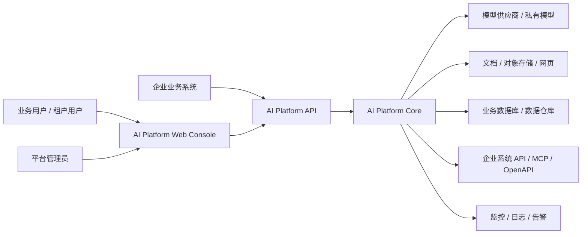
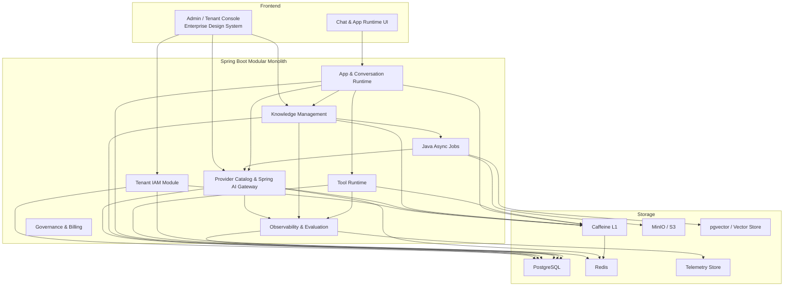
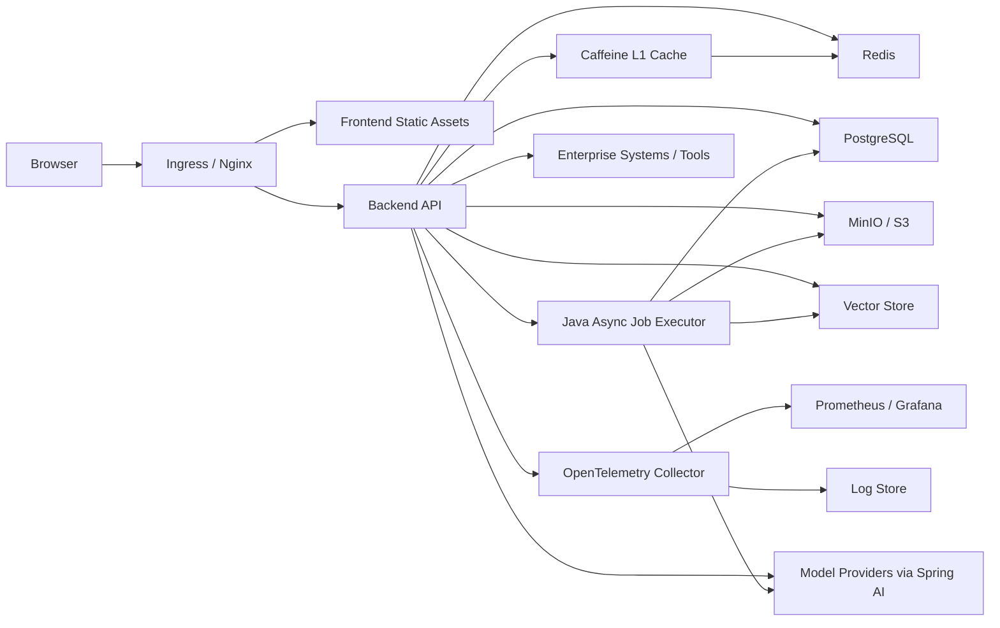

# 40 架构与技术方案

Stage: architecture  
Category: stage-main  
Status: current  
Review Status: agent-reviewed  
Reviewers: architect, engineering lead, security owner  
Approval: agent-approved  
Inputs: `docs/20-prd-and-scope.md`, `docs/30-project-harness.md`  
Outputs: 系统架构、模块边界、技术选型、ADR、handoff table  
Depends On: `docs/20-prd-and-scope.md`, `docs/30-project-harness.md`, `docs/31-context-loading.md`, `docs/32-control-surface.md`  
Load When: architecture/planning/implementation  
Next: `docs/45-module-and-service-design.md`, `docs/50-delivery-plan.md`

## 架构目标

构建供应商中立、可私有化、可多租户治理的企业 AI 平台。架构必须先保证租户、权限、审计、配置、模型网关、知识运行时、工具治理和观测数据模型，再逐步增强低代码编排和智能应用体验。

## 技术基线状态

后端框架基线已由用户确认；S1 运行时依赖、S2 后端基线和 S3 前后端鉴权纵切已通过真实环境验证。为避免后续 build-ready 误判，本节区分确认项和架构推荐项。

### 已确认项

- 架构方法：TDD + DDD，启用 `springboot-enterprise-ddd` profile。
- 后端控制面与 AI 运行时：Java 21 + Spring Boot 3，模块化单体起步。
- AI 基础能力：Spring AI，统一封装 chat、embedding、rerank、tool calling、prompt、advisor / retrieval 能力。
- 登录、会话、权限：Sa-Token + Redis-backed session。
- 持久化：MyBatis-Plus，domain 层只依赖 repository port，不依赖 mapper / PO。
- 缓存和限流：Redis + Redisson + Caffeine，采用 Caffeine L1 + Redisson/Redis L2 的二级缓存。
- API 工程规范：统一响应、统一异常、统一错误码、统一注释规范。
- 研发依赖：本地 Docker Compose 启动 PostgreSQL、Redis、MinIO，`deploy/scripts/healthcheck.sh` 已通过。
- 后端基线：Maven 多模块 + `ai-platform-bom` + 平台基础设施骨架，`mvn -f backend/pom.xml test` 已通过。
- 可运行纵切：Spring Boot 可执行 jar + Vue 3 控制台 + 真实 PostgreSQL/Redis/MinIO，登录、当前用户、当前租户、403、登出已通过 API 和页面 smoke。
- 控制台分层：首期控制台必须同时承载平台管理和租户平台；菜单、角色、权限由 IAM 返回，前端不得硬编码可访问功能。
- 部署模式：私有化优先；本地开发采用 Docker Compose 依赖 + 前后端本机进程。
- 前端：Vue 3 + TypeScript + Vite。
- 前端设计系统：企业级控制台规范见 `docs/45-details/03-frontend-console-design-system.md`；所有页面必须复用统一 token、布局、表单、表格、按钮、消息、状态和响应式规则。
- 租户隔离：首期共享库共享表 + `tenant_id` 强隔离 + MyBatis-Plus `TenantLineInnerInterceptor`。

### 架构推荐待评审 / 待验证项

- 前端组件库：暂不引入额外企业组件库；当前采用 Vue 3 + TypeScript + 原生 CSS token 建立企业控制台设计系统，后续仅在复杂表格、表单、弹层和可访问性成本明显升高时再评估组件库。
- 主库：PostgreSQL。
- 向量：首期 pgvector，后续可插拔 Milvus / Qdrant / Elasticsearch / OpenSearch。
- 对象存储：MinIO / S3。
- 异步任务：首期 Java 内部任务调度 + 数据库任务表，规模提升后 Kafka / RabbitMQ。
- 可观测：OpenTelemetry + Prometheus / Grafana + 结构化日志。
- 部署：本地研发环境已验证；后续生产发布形态仍需在 release 阶段细化。

理由：用户明确要求不引入 Python 复杂度，因此 AI 能力统一纳入 Java / Spring 体系，通过 Spring AI 和 adapter 层吸收模型供应商差异；模块化单体能降低早期分布式复杂度，同时保留后续按 bounded context 拆分服务的边界。

## 平台基础设施模块原则

框架和外部依赖能力应作为与业务模块同级的平台基础设施模块，但不得拥有业务事实和业务流程。详细模块边界见 `docs/45-details/02-platform-infrastructure-design.md`。

| 基础设施模块 | 封装能力 | 业务事实归属 |
| --- | --- | --- |
| `ai-platform-ai` | Spring AI、ChatClient、EmbeddingModel、VectorStore、Advisor、ToolCallback、AI observation | provider / model 归 `model`，知识策略归 `knowledge/retrieval`，工具授权归 `tool` |
| `ai-platform-cache` | Redisson、Caffeine、二级缓存、失效广播、cache metrics | 具体缓存哪些业务数据由各业务 context 的 cache spec 决定 |
| `ai-platform-security` | Sa-Token、principal codec、路由拦截、session helper、auth exception mapping | 用户、角色、权限和资源 ACL 归 `tenant` / IAM |
| `ai-platform-persistence` | MyBatis-Plus 配置、tenant interceptor、分页、乐观锁、防全表、审计字段填充 | 业务 PO / Mapper / SQL 归各 context 的 `infrastructure/persistence` |
| `ai-platform-storage` | MinIO / S3 SDK、object key、pre-signed URL、multipart、checksum | 文档、知识库、ACL、解析任务归 `knowledge` |
| `ai-platform-telemetry` | OpenTelemetry、metrics、日志脱敏、framework observation bridge | usage、eval、billing、alert 业务模型归 `observability` / `governance` |

依赖规则：

- 基础设施模块可以依赖 `ai-platform-shared`。
- 基础设施模块禁止依赖业务模块。
- 业务模块的 `domain` 禁止依赖任何基础设施模块和第三方框架类型。
- 业务模块的 `infrastructure` 可以依赖基础设施模块，用来实现业务 port。
- `ai-platform-boot` 负责组合基础设施模块和业务模块。

## 框架官方资料校准后的架构落点

详细资料源见 `docs/facts/framework-official-research.md`。本节只保留对架构有约束力的结论。

### Spring AI

Spring AI 在本项目中不是“直接 provider SDK 包装层”，而是由 `ai-platform-ai` 承载的 AI runtime 基础设施能力集合：

- `ChatClient`：只允许在 Model Gateway adapter 中构建和调用，负责 chat、streaming、structured output、prompt template 的统一入口。
- Advisor / RAG：由 Retrieval Runtime 组织 `QuestionAnswerAdvisor`、`RetrievalAugmentationAdvisor`、query transform、metadata filter 和 context assembly。
- Tool calling：由 Tool Runtime 生成经过授权的 `ToolCallback` / tool definition，Model Gateway 只接收已批准工具集合。
- `VectorStore` / PGvector：作为 Knowledge Retrieval 的 infrastructure adapter，metadata filter 必须携带 tenant、knowledge base、document ACL。
- Observability：接入 Spring Boot Actuator 后采集 ChatClient、ChatModel、EmbeddingModel、VectorStore、Tool 调用信号，再由 Observability module 补齐租户、应用、知识库、成本和错误码维度。

架构规则：

- 业务 controller 和 application service 不直接注入 Spring AI 类型。
- provider secret 不进入 `application.yml`，只通过租户级配置和 secret store 在 adapter 层装配。
- prompt、completion、tool 参数和向量查询结果默认不明文写日志或 trace。
- RAG 空上下文不得伪造成成功回答，必须保留可评估的未命中 trace。

### Sa-Token

Sa-Token 在本项目中由 `ai-platform-security` 承载，提供登录、会话、路由拦截、权限和角色校验的技术基础能力：

- `StpUtil` 只在 `SaTokenAuthAdapter` / auth infrastructure 中使用。
- `AuthApplicationService` 暴露登录、登出、当前主体、token 续期、踢下线和权限检查用例。
- Redis-backed session 是生产默认状态，内存 session 不能作为验收完成态。
- token login id 只存雪花 Long 型 `tenantId`、`actorType`、雪花 Long 型 `actorId` 主体引用；角色和权限实时从 IAM 事实源查询。
- 平台所有业务表主键统一命名为 `id`，数据库类型为 `BIGINT`，由平台雪花 Long ID 生成；`tenant_id`、`user_id`、`provider_id`、`model_id` 等字段只能作为 Long 关联键。
- `tenant_code`、`username`、`provider_name`、`model_code` 是业务唯一键或展示/配置键，不得作为跨表主键或外键。
- Sa-Token 异常在 controller advice 中转换为统一 `AUTH_*` / `PERMISSION_*` 错误码。

### MyBatis-Plus

MyBatis-Plus 在本项目中由 `ai-platform-persistence` 承载基础配置，各业务 context 只在自身 `infrastructure/persistence` 放置业务 mapper / PO：

- `mapper-locations` 使用 `classpath*:/mapper/**/*.xml`，保证 Maven 多模块中的 XML 都能加载。
- `MybatisPlusInterceptor` 统一在 boot/shared infrastructure 配置，插件顺序为 tenant/dynamic table、pagination/optimistic lock、illegal SQL/block attack。
- `TenantLineInnerInterceptor` 是共享库字段隔离默认控制点，默认字段为 Long 型 `tenant_id`。
- `PaginationInnerInterceptor` 使用 PostgreSQL `DbType`，并由 BOM 管理 `mybatis-plus-jsqlparser`。
- 配置类聚合和并发敏感表启用 `OptimisticLockerInnerInterceptor` + `@Version`。
- `BlockAttackInnerInterceptor` 作为默认安全保护，防止无条件全表更新/删除。
- `MetaObjectHandler` 统一填充租户、创建/更新人、时间、逻辑删除和版本字段。

### Redisson + Caffeine

缓存层不是业务事实源，只用于降低高频读取和远程依赖开销。详细资料源见 `docs/facts/cache-official-research.md`。

- L1：Caffeine，进程内缓存，容量小、TTL 短，只服务热点读。
- L2：Redisson 访问 Redis，作为分布式缓存和跨节点失效事件通道。
- 统一入口：`TwoLevelCacheFacade` / `TwoLevelCacheManager`，业务模块不得各自创建缓存。
- 失效机制：业务事务提交后删除 L2，并通过 Redisson topic 广播 invalidation event，所有节点收到后删除 L1。
- 观测：每个 cacheName 输出 L1/L2 hit-miss、loader latency、eviction、invalidation lag、stale served、serialization error。
- 故障策略：权限、租户、限流、工具策略缓存 fail closed；只读低风险字典允许有限 stale。

## 研发环境与部署资产

研发环境资产统一放入 `deploy/`：

```text
deploy/
  README.md
  .env.example
  docker-compose.yml
  scripts/
    up.sh
    down.sh
    healthcheck.sh
```

第一研发切片必须先让 PostgreSQL + pgvector、Redis、MinIO 真实启动并通过健康检查。后端骨架、Sa-Token Redis session、MyBatis-Plus migration、文档对象存储和向量能力都必须连接这些真实依赖。

## 系统上下文



## Bounded Context

| Context | 职责 | 数据所有权 |
| --- | --- | --- |
| Tenant & IAM | 租户、用户、角色、权限、资源归属、API key | tenant, user, role, permission, resource_acl |
| Provider & Model Gateway | 平台模型选项、租户 provider、租户模型配置、API Key 加密、能力类型、模型参数、路由、限流、调用、成本 | platform_provider_type, platform_model_option, model_provider, model_catalog, model_invocation_record |
| Knowledge Management | 知识源、文档、数据库连接、ingestion job、索引配置 | knowledge_base, source, document, chunk, index_job |
| Retrieval Runtime | 检索策略、metadata filter、rerank、引用、命中记录 | retrieval_trace, citation, chunk_hit |
| App & Conversation Runtime | AI 应用、prompt、会话、消息、反馈、发布 | app, app_version, conversation, message, feedback |
| Tool Runtime | tool catalog、schema、凭证、执行策略、审批、审计 | tool, credential_ref, tool_run, approval |
| Observability & Evaluation | trace、metrics、eval dataset、质量评分、告警 | ai_trace, metric_rollup, eval_run, alert_rule |
| Governance & Billing | 配额、预算、账单、保留策略、审计查询 | quota, budget, cost_record, audit_log |

## 模块图



## 运行时 / 部署视图



## 关键链路

### 知识库问答链路

1. 用户请求进入 App Runtime。
2. IAM 校验租户、应用和知识库权限。
3. Retrieval Runtime 根据应用配置执行 query rewrite、metadata filter、hybrid search、rerank。
4. Model Gateway 组装 prompt、上下文和安全策略后调用模型。
5. 结果返回引用、命中 chunk、token、成本和 trace。
6. Observability 写入会话、检索、模型调用和质量反馈。

### 文档 ingestion 链路

1. 知识工程师上传或同步文档。
2. Knowledge Management 创建 ingestion job。
3. Java ingestion job 拉取对象存储文件，调用 parser provider。
4. 生成 document、section、chunk、metadata、ACL。
5. Embedding job 通过 Spring AI embedding adapter 写入 vector index。
6. 质量检查记录解析失败、低质量 chunk、重复内容和索引状态。

### 工具调用链路

1. App Runtime 根据模型 tool call 请求选择 tool。
2. Tool Runtime 校验应用授权、租户策略、工具风险等级和审批要求。
3. 低风险只读 tool 直接执行，高风险写入 tool 进入 approval。
4. 执行结果回传模型，同时写入 tool_run、audit_log 和 trace。

### 二级缓存链路

1. 应用查询通过 cache port 进入 `TwoLevelCacheFacade`。
2. 先查 Caffeine L1；命中直接返回并记录 L1 hit。
3. L1 miss 查 Redisson/Redis L2；命中后回填 L1。
4. L2 miss 调用 loader 读取数据库或配置事实源；成功后先写 L2，再写 L1。
5. 写操作提交数据库事务后，通过 `AFTER_COMMIT` 事件删除 L2，并发布 Redisson invalidation topic。
6. 所有后端实例收到 invalidation event 后删除本地 Caffeine L1。
7. Redis 不可用时，权限、租户状态、限流和工具策略 fail closed；低风险只读字典可按 cache spec 使用有限 stale。

## 数据一致性

| 数据 | 一致性 | 事务边界 | 说明 |
| --- | --- | --- | --- |
| tenant / IAM | 强一致 | 单库事务 | 权限变更必须立即生效 |
| provider config | 强一致 | 单库事务 + secret store | 密钥写入成功后才能启用 |
| document ingestion | 最终一致 | job 状态机 | 文档、chunk、embedding 分阶段完成 |
| vector index | 最终一致 | job + retry | 索引失败可重试和重建 |
| two-level cache | 事务后失效 + 短 TTL 最终一致 | DB commit 后 cache eviction | L1 TTL 必须小于 L2 TTL，失效事件跨节点传播 |
| conversation | 强一致写入消息，异步聚合指标 | API 事务 + telemetry append | 不阻塞异步 rollup |
| metrics rollup | 最终一致 | 批处理 | 原始 trace 是事实源 |
| tool execution | 强一致审计 | tool_run + audit_log | 高风险动作先审计再执行或审批 |

## DDD 分层与目录映射

后端采用 Maven 多模块组装，`groupId` 固定为 `org.fujay`，所有后端模块 `artifactId` 必须以 `ai-` 开头，`ai-platform-bom` 统一管理 Maven 依赖版本：

```text
backend/
  pom.xml
  infrastructure/
    ai-platform-bom/
    ai-platform-shared/
    ai-platform-ai/
    ai-platform-cache/
    ai-platform-security/
    ai-platform-persistence/
    ai-platform-storage/
    ai-platform-telemetry/
  apps/
    ai-platform-boot/
  business/
    ai-platform-modules/
      tenant/
      model/
      knowledge/
      retrieval/
      conversation/
      tool/
      observability/
      governance/
  quality/
    ai-platform-architecture-tests/
```

后端按 bounded context 拆 Maven module，每个 context 内部使用统一分层：

```text
business/ai-platform-modules/<context>/
  src/main/java/org/fujay/ai/platform/<context>/
    interfaces/
    application/
    domain/
    infrastructure/
```

分层约束：

- `interfaces`：controller、request、response、assembler、参数校验和协议翻译。
- `application`：command/query handler、事务边界、用例编排、权限检查和事件发布。
- `domain`：aggregate、entity、value object、domain service、repository port、domain event。
- `infrastructure`：业务 adapter 包，依赖平台基础设施模块实现业务 port。
- `ai-platform-ai/cache/security/persistence/storage/telemetry`：平台基础设施能力，不承载业务事实源。
- `shared`：只放稳定共享内核，例如 `TenantId`、`TraceId`、`ErrorCode`、`ApiResponse`、领域异常基类。
- 详细代码组织规范见 `docs/45-details/01-backend-code-organization.md`；开发某个后端模块时优先读取该文档，不需要全量读取本架构文档。
- 前端控制台设计系统见 `docs/45-details/03-frontend-console-design-system.md`；开发或调整任何前端页面时优先读取该文档，不得只按单页视觉临时堆叠样式。

## TDD 执行规则

每个生产切片遵循：

1. RED：先写一个失败测试，明确目标行为。
2. GREEN：用最小实现通过测试。
3. REFACTOR：在测试保持通过的前提下重构结构。

测试层级：

- Domain tests：聚合不变量、值对象约束、状态迁移。
- Application tests：命令编排、事务边界、权限、幂等、事件发布。
- Infrastructure tests：MyBatis-Plus repository、Spring AI adapter、Sa-Token integration、外部 adapter。
- Interface tests：HTTP 契约、统一响应、统一异常、参数校验。
- Architecture tests：DDD 分层、禁止基础设施类型进入 domain。

## 接口契约草案

首期 API 边界：

- `/api/admin/tenants`
- `/api/admin/tenants/{tenantId}/status`
- `/api/admin/users`
- `/api/admin/roles`
- `/api/admin/menus`
- `/api/model-providers`
- `/api/model-providers/options`
- `/api/models`
- `/api/knowledge-bases`
- `/api/knowledge-sources`
- `/api/ingestion-jobs`
- `/api/apps`
- `/api/apps/{appId}/chat`
- `/api/tools`
- `/api/tool-runs`
- `/api/observability/usage`
- `/api/observability/traces`
- `/api/evals`

所有 API 必须携带认证主体、租户上下文和 trace id。跨租户管理 API 只能由平台管理员调用。
任何新业务 API 必须先判定属于平台管理还是租户平台，再绑定到 IAM permission 和 menu；没有权限码、菜单入口和前端可达路径的接口不得视为闭环功能。

统一响应结构：

```json
{
  "code": "0",
  "message": "ok",
  "data": {},
  "traceId": "trace-id"
}
```

异常语义：

- 业务异常：使用统一 `BusinessException` / `DomainException`，携带稳定错误码。
- 权限异常：由 Sa-Token 或 IAM permission bridge 转换为统一 `AUTH_*` / `PERMISSION_*` 错误码。
- 外部依赖异常：provider、vector store、tool、database connector 统一归一为可诊断错误。
- 所有异常响应必须包含 `traceId`，不得暴露密钥、SQL 明文或供应商敏感响应。

## 安全与租户隔离

- 身份：Sa-Token 实现登录、登出、当前用户、token 续期和失效；session/token 状态写入 Redis。
- 授权：Sa-Token `StpInterface` 或等价 permission bridge 对接 IAM 权限事实，RBAC + resource ACL。
- 菜单：平台管理菜单只暴露给平台管理员或被授权租户管理员；租户平台菜单按当前租户角色授权。前端只能渲染 `/api/auth/me` 返回的菜单，不能用静态路由绕过后端权限事实。
- Principal：token login id 只承载租户、主体类型和主体 ID；角色和权限必须从 IAM 查询，不写入 token payload。
- 租户隔离：首期采用共享库共享表 + `tenant_id` 强隔离 + MyBatis-Plus `TenantLineInnerInterceptor`；高合规场景预留 schema / instance isolation。
- 密钥：provider secret、tool credential、database credential 必须加密存储；业务日志不得打印明文。
- 审计：模型配置、知识源配置、工具配置、工具执行、高风险导出和权限变更必须审计；`audit_log` 事实源归 Governance & Billing，其他模块通过 audit port 追加审计事件。
- 数据访问：数据库知识源默认只读；通过 schema 白名单、SQL 模板、语义层和 query guard 控制。

## 技术选型 ADR 摘要

| ADR | 选择 | 备选 | 原因 | 代价 |
| --- | --- | --- | --- | --- |
| 架构形态 | Spring Boot 模块化单体 + Java async jobs | 一开始微服务 / Python worker | 用户要求不引入 Python；早期边界仍在收敛，模块化单体更利于一致性和交付 | 后续需要拆分策略 |
| 主后端 | Java / Spring Boot | Node.js / Python 全栈 | 企业权限、事务、审计和长线维护成熟 | AI SDK 生态需要 adapter |
| AI 基础能力 | Spring AI + 自有 adapter | 直接 provider SDK / Python worker | 官方能力覆盖 ChatClient、Advisor/RAG、ToolCallback、VectorStore 和 observability，适合统一模型网关和知识问答 | 需要补齐厂商差异抽象、租户级密钥装配和 contract test |
| 二级缓存 | Caffeine L1 + Redisson/Redis L2 | Redis-only / Caffeine-only / Redisson PRO near-cache | 本地热点读取低延迟，Redis 提供跨节点共享和失效广播，开源可控 | 需要严格 cache spec、失效事件、观测和故障策略 |
| 登录权限 | Sa-Token + Redis | Spring Security / 自研 token | 用户指定；官方能力覆盖登录、会话、权限、角色、踢下线和 Spring Boot 集成 | 必须补 production-grade Redis session、permission bridge 和统一异常翻译 |
| 持久化 | MyBatis-Plus | JPA / MyBatis 手写 | 用户指定；官方能力覆盖 Spring Boot 配置、Mapper、多租户、分页、乐观锁和安全插件 | 必须防止 PO / Mapper / Wrapper 泄漏到 domain，并强制 tenant 插件 |
| 向量存储 | pgvector 起步，可插拔 | 直接 Milvus / Qdrant | 早期降低基础设施复杂度 | 大规模场景需迁移 |
| 工具协议 | OpenAPI + HTTP + MCP 扩展 | 自定义协议 | 行业生态更兼容 | 需要严格 schema 和权限治理 |
| 观测 | OpenTelemetry 贯穿 | 业务日志拼接 | 适合跨模型、检索、工具和 API trace | 初始接入成本更高 |

## 扩展性策略

- 新模型供应商通过 `AiProviderType` + `AiGatewayClientFactory` + provider adapter 接入，业务应用只依赖 `AiGatewayFacade`，不得在 application service 中写具体厂商分支。
- 新后台功能必须先归类为平台管理或租户平台：平台功能写入平台菜单和平台权限，租户功能写入租户菜单和租户权限，并在前后端同时完成菜单入口、权限注解、API contract 和页面 smoke。
- 新前端页面必须先继承企业控制台设计系统；完成态必须同时包含真实 API/menu/permission 闭环、状态反馈、表单/表格密度、响应式和视觉一致性。
- 新知识源通过 source connector 接入，不修改 retrieval runtime。
- 新向量库通过 vector store port 接入，不修改 knowledge domain。
- 新工具协议通过 tool executor adapter 接入，不绕过 tool policy。
- 从模块化单体拆分服务时，以 bounded context 和数据所有权为拆分依据。

## Delivery Handoff Table

切片编号以 `docs/50-delivery-plan.md` 为唯一事实源。本表只做架构到交付的摘要映射，不重新定义编号和顺序。

| Delivery Slice | Architecture Area | 允许目录 | 关键依赖 | Owner | 验收重点 |
| --- | --- | --- | --- | --- | --- |
| S1 Dev Environment | Runtime dependencies | `deploy`, `docs/facts`, `scripts` | PostgreSQL + pgvector, Redis, MinIO | environment owner | 真实依赖启动和健康检查 |
| S2 Backend Maven Baseline | Platform infrastructure + module skeleton | `backend`, `docs/45-details`, `docs/60` | Maven BOM, `ai-platform-*` infrastructure modules | platform owner | Maven 多模块、BOM、groupId/artifactId、依赖边界 |
| S3 App Skeleton + Auth | Tenant/IAM + UI + API | `backend`, `frontend`, `deploy`, `docs/60` | DB, Sa-Token, Redis, audit, cache baseline | platform + frontend | 可启动、登录、租户隔离、受保护页面、真实权限拒绝 |
| S4-S5 Provider / Model Gateway | Provider & Model Gateway | `ai-platform-modules/model`, `ai-platform-ai` | `ai-platform-ai`, secret, quota, telemetry | model owner | provider CRUD、连接测试、统一调用、限流、成本记录 |
| S6-S7 Document KB / Retrieval | Knowledge + Retrieval | `ai-platform-modules/knowledge`, `ai-platform-modules/retrieval`, `ai-platform-storage` | storage, vector, parser, Spring AI embedding | knowledge owner | 上传、解析、索引、引用问答、retrieval trace |
| S8 Database Knowledge Source | Knowledge + Governance | `ai-platform-modules/knowledge`, `ai-platform-modules/retrieval` | DB connector, semantic layer, SQL guard | knowledge + security | 只读连接、schema 白名单、安全查询 |
| S9-S10 Tool Runtime / Approval | Tool Runtime | `ai-platform-modules/tool` | IAM, audit port, approval, `ai-platform-ai` tool bridge | tool owner | tool catalog、执行、审批、审计事件写入 |
| S11-S12 Observability / Eval | Observability & Evaluation | `ai-platform-modules/observability`, `ai-platform-telemetry` | all runtime traces | observability owner | usage、trace、eval、告警 |

## Build Ready 结论

`pass-for-s4`。

原因：

- 后端技术栈、部署模式、前端方案和租户隔离等级已确认。
- S1 `deploy` 真实依赖已有运行证据。
- S2 Maven 多模块和结构测试已有运行证据。
- S3 前后端本机进程、真实 API/UI smoke 和页面无非预期错误证据已形成。
- S4 Provider Catalog、平台模型选项目录、租户模型配置、RBAC/menu、SiliconFlow 真实模型调用和页面操作证据已形成。
- CI、生产发布和回滚仍未建立，属于后续工程化切片，不阻塞 S5.1 启动。
