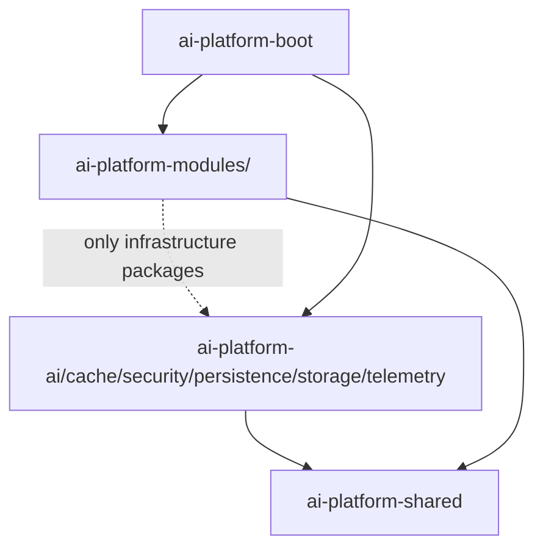

# 02 平台基础设施模块设计

Stage: module-design-detail  
Category: design-detail  
Status: current  
Review Status: agent-reviewed  
Reviewers: architect, backend lead  
Approval: agent-approved  
Inputs: `docs/40-architecture-and-tech-spec.md`, `docs/45-details/01-backend-code-organization.md`  
Outputs: 平台基础设施模块边界、依赖规则、禁止项和测试要求  
Depends On: `docs/32-control-surface.md`, `docs/45-details/00-index.md`  
Load When: platform-infrastructure/backend-module-development  
Next: S3 鉴权纵切中的基础设施装配

## 结论

除业务 bounded context 之外的框架能力适合作为平台基础设施模块，但必须满足一个前提：基础设施模块只封装技术能力和外部依赖，不拥有业务事实、业务流程和业务权限决策。

因此：

- Spring AI 适合抽成 `ai-platform-ai`。
- Redisson + Caffeine 适合抽成 `ai-platform-cache`。
- Sa-Token 适合抽成 `ai-platform-security`。
- MyBatis-Plus 适合抽成 `ai-platform-persistence`。
- MinIO / S3 适合抽成 `ai-platform-storage`。
- OpenTelemetry / metrics / logging 基础能力适合抽成 `ai-platform-telemetry`。

后端类型目录固定为 `apps / infrastructure / business / quality`。BOM 与 shared kernel 也归入 `backend/infrastructure`，但职责与框架集成模块不同：

- `infrastructure/ai-platform-bom`：纯依赖版本治理，不承载代码和业务事实。
- `infrastructure/ai-platform-shared`：纯稳定共享类型，不依赖具体框架。
- `ai-platform-*` infrastructure：框架集成、技术 facade、配置、adapter helper。
- `ai-platform-modules/<context>`：业务事实、业务用例、业务端口、业务 adapter。
- `ai-platform-boot`：装配入口，负责把基础设施模块和业务模块组合成可运行应用。

## 判断标准

一个能力适合作为平台基础设施模块，当且仅当它满足：

- 被多个业务 context 复用。
- 主要职责是封装框架、协议、SDK、连接池、序列化、观测或通用技术策略。
- 自身不拥有业务聚合、业务生命周期或业务审批。
- 可以通过通用 contract test 验证，不依赖具体业务场景。
- 可以被替换为另一种技术实现而不改变业务语义。

不适合作为基础设施模块的内容：

- 租户、用户、角色、权限事实。
- provider 配置生命周期、模型目录业务规则。
- 知识库、文档、chunk、索引任务。
- tool 授权、审批、审计和风险等级。
- 应用、prompt、会话、消息和反馈。
- usage、billing、eval 的业务数据模型。

## 模块清单

| 模块 | 技术能力 | 可以做 | 不能做 |
| --- | --- | --- | --- |
| `ai-platform-ai` | Spring AI | `ChatClient` / `ChatModel` / `EmbeddingModel` / `VectorStore` 工厂、advisor helper、tool callback bridge、observability customizer、provider option 映射工具 | 拥有 provider 配置、知识库策略、tool 审批、应用 prompt |
| `ai-platform-cache` | Redisson + Caffeine | L1/L2 cache facade、cache spec、key builder、serializer、失效 topic、metrics、热点保护 | 持久化业务事实、缓存敏感明文、替代 repository |
| `ai-platform-security` | Sa-Token | `StpUtil` 封装、principal codec、route interceptor、auth exception mapping、session helper | 拥有用户/角色/权限事实，决定业务授权结果 |
| `ai-platform-persistence` | MyBatis-Plus | interceptor 配置、tenant line、pagination、optimistic lock、block attack、meta object handler、type handler、mapper scan 约定 | 放置业务 PO / Mapper、业务 SQL、业务 repository |
| `ai-platform-storage` | MinIO / S3 | object client、bucket policy、object key builder、pre-signed URL、multipart upload、checksum、storage metrics | 拥有文档业务状态、知识库 ACL、文件解析策略 |
| `ai-platform-telemetry` | OpenTelemetry / metrics / logging | trace id、meter registry helper、span tag policy、log sanitizer、framework observation bridge | 拥有 AI eval、usage rollup、billing 业务事实 |
| `ai-platform-job` | Java scheduler / outbox | job executor、retry、lock、outbox dispatcher、dead letter 基础能力 | 拥有 ingestion、embedding、billing 等业务 job 语义 |

`ai-platform-job` 可以在需要异步任务统一化时创建；S1/S2 不强制。

## 依赖规则



规则：

- 基础设施模块可以依赖 `ai-platform-shared`。
- 基础设施模块之间默认不互相依赖；确需依赖必须写入本文件。
- 基础设施模块禁止依赖 `ai-platform-modules/<context>`。
- 业务模块的 `domain` 包禁止依赖任何基础设施模块。
- 业务模块的 `application` 包优先定义业务 port，不直接依赖框架类型。
- 业务模块的 `infrastructure` 包可以依赖基础设施模块，用来实现业务 port。
- `ai-platform-boot` 负责 Spring Bean 装配、配置绑定和模块扫描。

## 推荐目录

```text
backend/
  infrastructure/
    ai-platform-bom/
    ai-platform-shared/
    ai-platform-ai/
    ai-platform-cache/
    ai-platform-security/
    ai-platform-persistence/
    ai-platform-storage/
    ai-platform-telemetry/
  apps/
    ai-platform-boot/
  business/
    ai-platform-modules/
      tenant/
      model/
      knowledge/
      retrieval/
      conversation/
      tool/
      observability/
      governance/
  quality/
    ai-platform-architecture-tests/
```

所有模块仍然遵守：

- `groupId=org.fujay`
- `artifactId` 以 `ai-` 开头
- 版本由 `ai-platform-bom` 管理

## 分模块边界

### ai-platform-ai

包结构：

```text
org.fujay.ai.platform.ai/
  chat/
  embedding/
  vectorstore/
  advisor/
  tool/
  observation/
  provider/
  error/
```

职责：

- 封装 Spring AI 类型和创建逻辑。
- 提供 provider client factory、model option mapper、tool callback bridge。
- 统一 Spring AI observation、错误归一、敏感字段脱敏。

禁止：

- 存储 provider secret。
- 决定某租户可用哪些模型。
- 决定某工具是否允许执行。
- 存储 prompt、conversation、message。

### ai-platform-security

包结构：

```text
org.fujay.ai.platform.security/
  satoken/
  principal/
  route/
  exception/
  session/
```

职责：

- 封装 Sa-Token `StpUtil`。
- 编解码 login id。
- 配置 `/api/**` 路由拦截。
- 转换 Sa-Token 异常为平台错误码。

禁止：

- 直接查询或维护角色/权限事实。
- 硬编码业务 permission code。
- 持有租户授权决策。

Tenant & IAM 模块通过 `PermissionQueryPort` / `CurrentPrincipalPort` 接入。

### ai-platform-persistence

包结构：

```text
org.fujay.ai.platform.persistence/
  mybatis/
  tenant/
  audit/
  pagination/
  typehandler/
  sqlguard/
```

职责：

- 统一 MyBatis-Plus 配置。
- 注册 tenant、pagination、optimistic lock、illegal SQL、block attack 插件。
- 提供审计字段填充和通用 type handler。

禁止：

- 放置业务 `Mapper`、业务 PO、业务 XML。
- 直接暴露 MyBatis-Plus `IPage` 到 controller。
- 让 domain 依赖 MyBatis-Plus 类型。

### ai-platform-storage

包结构：

```text
org.fujay.ai.platform.storage/
  object/
  s3/
  minio/
  key/
  presign/
  checksum/
```

职责：

- 封装 MinIO / S3 SDK。
- 统一 bucket、object key、content type、checksum、multipart upload、pre-signed URL。
- 输出 storage metrics 和错误归一。

禁止：

- 决定文档属于哪个知识库。
- 判断用户是否能访问文档。
- 触发文档解析或 embedding。

Knowledge 模块通过业务端口调用 storage adapter。

## 测试要求

每个基础设施模块必须至少具备：

- Configuration test：配置绑定和 Bean 装配可验证。
- Contract test：核心 facade 行为稳定。
- Failure mapping test：外部框架异常转换为平台异常。
- Boundary test：domain 不依赖基础设施模块。
- Sensitive data test：日志、trace、cache、exception 不泄漏密钥和敏感明文。

## 机械化检查建议

后续实现时增加扫描：

- `domain` 包不得 import `org.fujay.ai.platform.ai/cache/security/persistence/storage/telemetry`。
- `domain` 包不得 import `org.springframework.ai`、`cn.dev33.satoken`、`com.baomidou.mybatisplus`、`org.redisson`、`com.github.benmanes.caffeine`、S3/MinIO SDK。
- 非 `ai-platform-security` 不得直接调用 `StpUtil`。
- 非 `ai-platform-ai` 不得直接构造 Spring AI `ChatClient`。
- 非 `ai-platform-cache` 不得直接创建 Caffeine cache 或 Redisson map。
- 非 `ai-platform-storage` 不得直接使用 MinIO / S3 SDK。
