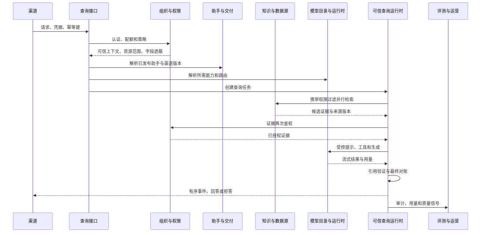

# 可信 RAG 基座后端设计

> ADR-0022 已将上下文内部结构调整为经典四层，并把三个 bootstrap 变成可执行应用。
> 详细依赖、目录和自动配置规则见
> `docs/architecture/foundation-backend-development-structure.md`。本文出现的 `api`、
> `adapter` 或 `runtimes` 旧路径不再作为实现依据。

## 1. 工程形态

第一阶段采用模块化单体和独立运行进程组合，优先保证领域边界、事务清晰、部署简单和可观测性。模块边界稳定且存在独立扩缩容证据后，才允许拆分服务。

后端采用“平台机制、限界上下文、编译期扩展、运行入口、测试支持、架构测试”六类模块：

```text
backend/
├── platform/
│   ├── platform-kernel/
│   ├── platform-web/
│   ├── platform-security/
│   ├── platform-persistence/
│   ├── platform-observability/
│   └── platform-outbox/
├── contexts/
│   ├── organization-access/
│   ├── knowledge-data/
│   ├── model-runtime/
│   ├── assistant-delivery/
│   ├── trusted-query/
│   ├── evaluation-operations/
│   └── profile-consent/
├── extensions/
│   ├── model-providers/
│   ├── data-connectors/
│   ├── vector-stores/
│   ├── object-stores/
│   ├── secret-stores/
│   ├── delivery-channels/
│   └── tool-providers/
├── runtimes/
│   ├── control-plane/
│   ├── query-runtime/
│   └── ingestion-worker/
├── test-support/
└── architecture-tests/
```

每个限界上下文默认是一个 Maven 模块，内部按 `api`、`domain`、`application`、`adapter` 分包。厂商、连接器、存储和渠道等高变化能力使用独立扩展模块。完整仓库树、模块模板、依赖矩阵、存储所有权和 M1 最小落地范围见 `docs/architecture/foundation-repository-layout.md`。

三个可部署进程：

| 进程 | 职责 | 禁止承担 |
| --- | --- | --- |
| `control-plane` | 租户、权限、数据源、模型、助手、评测和运维配置接口 | 在线生成和重型摄取 |
| `query-runtime` | 低延迟认证、授权、检索、生成、流式、审计和计量 | 管理配置编辑 |
| `ingestion-worker` | 连接、解析、切片、嵌入、索引、质量和发件箱任务 | 面向终端用户的同步问答 |

三个进程共享版本化领域与应用模块，但拥有独立启动模块、连接池、资源限制和扩缩容策略。

## 2. 依赖方向

```text
启动模块
  -> 入站与出站适配器
    -> 应用层
      -> 领域层

公开契约 <- 上下文适配器
```

- 领域层只依赖 JDK。
- 应用层依赖领域和端口，不依赖控制器、持久化实现或 Spring AI。
- 适配器实现端口并完成框架类型转换。
- 启动模块只负责装配、配置和进程入口。
- 上下文内部包默认不可见，只有公开契约包可被其他上下文依赖。
- 厂商和连接器扩展只依赖对应上下文的公开扩展接口。
- 平台机制不得依赖任何业务上下文。

## 3. Spring Boot 使用规范

- 使用构造器注入，禁止字段注入。
- 配置使用有校验的 `@ConfigurationProperties`，禁止在业务代码散落读取环境变量。
- 生产启动失败优于使用不安全默认值。
- 每个外部连接配置超时、连接池、重试边界、熔断和指标。
- 只在应用边界开启事务；领域对象不感知事务。
- 禁止在事务中执行不可控的模型调用、对象存储上传或长时间网络请求。
- 使用虚拟线程前必须以驱动兼容、线程局部变量、阻塞行为和容量测试为依据。
- 运行环境禁用 JDK 预览和孵化 API。
- 健康检查区分存活、就绪和依赖降级，避免依赖抖动导致重启风暴。

## 4. Spring AI 运行时

### 4.1 平台端口

平台按模型类型提供小接口：

- `ChatModelPort`
- `StreamingChatModelPort`
- `EmbeddingModelPort`
- `ImageGenerationModelPort`
- `ModerationModelPort`
- `TranscriptionModelPort`
- `TextToSpeechModelPort`
- `RerankPort`
- `ToolExecutionPort`
- `McpConnectionPort`

业务层只依赖这些端口和平台值对象，禁止直接创建或传递 `ChatModel`、`ChatClient`、`EmbeddingModel`、`Document`、`Advisor` 等 Spring AI 类型。

### 4.2 类型化工厂

基础设施层按模型类型拆分：

- `SpringAiChatModelFactory`
- `SpringAiEmbeddingModelFactory`
- `SpringAiImageModelFactory`
- `SpringAiModerationModelFactory`
- `SpringAiTranscriptionModelFactory`
- `SpringAiTextToSpeechModelFactory`
- `RerankModelFactory`

禁止创建一个同时处理全部模型类型的巨型供应商适配器。

首批设计支持：

- OpenAI
- Azure OpenAI
- Anthropic
- Google Vertex AI 与 Gemini
- Amazon Bedrock
- Mistral AI
- Ollama
- OpenAI Compatible

第一周只实现 OpenAI Compatible、Ollama、Chat 和 Embedding。其他适配器通过统一契约逐步加入，不修改核心领域契约，不支持运行时上传任意 JAR。

### 4.3 能力和配置

配置优先级固定为：

```text
平台安全上限
  -> 租户供应商配置
    -> 模型部署默认值
      -> 助手版本配置
        -> 受限请求覆盖
```

下层配置只能收窄，不能突破上层限制。

便携参数使用平台类型。厂商参数保存为带版本的命名空间，经过 JSON Schema、白名单和范围校验，不得包含地址、凭据、任意类名或脚本。

### 4.4 对象生命周期

Spring AI 运行时对象由工厂创建并缓存，缓存键至少包含：

```text
租户标识
+ 供应商连接标识与修订号
+ 模型部署标识与修订号
+ 模型类型
```

- 配置发布或撤销后主动淘汰相关缓存。
- 密钥轮换不回显旧值，运行时重新解析密钥引用。
- 构建失败不得污染已有可用缓存。
- 缓存命中、创建、淘汰和失败均记录指标。

### 4.5 顾问链顺序

顾问链顺序由代码常量和架构测试固定，页面不得任意拖动：

1. 可信上下文。
2. 配额。
3. 策略。
4. 内容安全。
5. 记忆。
6. 查询转换。
7. 检索。
8. 重排。
9. 证据再次鉴权。
10. 工具调用。
11. 生成。
12. 引用验证。
13. 用量与审计。

需要跳过某一环节时，由已发布助手版本和策略显式决定，不能由请求传入任意顾问类。

### 4.6 可观测性

- 使用 Micrometer 记录模型、顾问、嵌入、向量存储、Token、费用、延迟、回退和错误类型。
- 默认不记录提示词、回答全文、凭据、工具敏感参数和原始文档。
- 诊断采样必须经租户授权、字段遮蔽和有限保留期。
- 指标标签使用受控枚举与资源标识，不把问题文本、异常信息或用户标识作为高基数标签。

## 5. Sa-Token 安全适配

- Sa-Token 只位于安全适配器，不进入领域和应用接口。
- 人员会话、服务调用和设备凭据使用不同认证入口和有效期。
- 登录结果转换为 `TrustedRequestContext`，随后由领域策略完成资源授权。
- 路由注解只能提供粗粒度入口保护，不能代替租户、资源、行和字段授权。
- 缓存键必须包含租户、主体、凭据版本和策略版本。
- 登出、撤销、角色变化和策略发布都使相关会话与授权缓存失效。
- 跨租户切换必须重新认证或获得显式平台运营上下文，不能只修改请求参数。
- 设备凭据绑定固定助手、渠道、组织单元或门店范围，并限制来源、并发、频率和每日用量。

## 6. MyBatis-Plus 持久化规范

- 持久化对象只存在于适配器，不能作为领域实体或接口返回值。
- 仓储负责领域对象与持久化对象映射。
- 每张租户数据表包含 `tenant_id`，唯一键和查询索引包含租户边界。
- 租户插件只能作为纵深防御，应用查询仍必须显式携带租户条件。
- 使用乐观锁版本列保护聚合并发更新。
- 使用逻辑删除前必须证明不会破坏唯一约束、审计、保留和清除语义。
- 禁止使用忽略租户、全表更新和无条件删除的便捷能力。
- 分页接口使用稳定排序和游标，禁止深页偏移扫描。
- 批量操作限制大小，记录失败项并保证幂等。
- SQL 日志不得输出明文凭据、个人信息、提示词和文档正文。
- 数据库迁移由版本化迁移工具管理，禁止运行时自动修改生产结构。

## 7. Hutool 使用边界

Hutool 仅用于经过评审的基础设施辅助能力。以下内容禁止委托给通用工具方法：

- 身份与权限判断。
- 密码学协议和密钥管理。
- 金额、Token 和配额计算。
- 领域时间、版本和状态转换。
- SSRF、防重放、签名和输入安全。
- 领域对象之间的反射复制。

标准 JDK、Spring 或专用安全库能够清晰表达时优先使用其能力。Hutool 升级必须通过许可证、漏洞和行为回归检查。

## 8. 可信查询执行



结构化和非结构化检索可以并行，但都必须在同一可信上下文、数据版本和权限决定下执行。超时后只能使用明确标记的部分结果；不能把未完成来源当作空结果掩盖。

## 9. 可靠性

- 所有写接口支持 `Idempotency-Key`，作用域为租户、主体、操作和请求摘要。
- 外部调用使用明确连接、读取、总时限和取消传播。
- 只对可重试错误进行有上限、带抖动的退避重试。
- 模型限流、超时、认证失败、内容拒绝、协议错误和能力不足使用不同错误类型。
- 熔断按供应商连接与模型部署隔离，避免一个厂商拖垮全部路由。
- 查询事件使用单调递增序号，重连可从最后确认序号继续。
- 领域事件使用事务发件箱和幂等消费者。
- 优雅停机停止接收新查询，给进行中任务有限完成窗口，然后取消并对账。

## 10. 数据与密钥安全

- 数据库只保存 `credentialReference`。
- 密钥由 Vault 端口按租户、用途和版本读取。
- 出站地址在保存和每次解析后都校验协议、域名、DNS 结果、端口和网络范围。
- 默认禁止环回、链路本地、云元数据地址和私有网络；例外由运维审批并审计。
- 重定向必须重新执行地址策略。
- 日志、异常、审计和接口响应统一脱敏。
- 对象存储、向量数据、数据库和备份使用独立租户命名空间及最小权限身份。

## 11. 性能与容量

第一周演示目标用于暴露架构问题，不代表最终生产服务等级：

| 路径 | 目标 |
| --- | --- |
| 鉴权和策略本地处理 | 第 95 百分位小于 40 毫秒 |
| 结构化查询，不含模型 | 第 95 百分位小于 300 毫秒 |
| 混合检索与重排 | 第 95 百分位小于 800 毫秒 |
| 流式首 Token | 第 95 百分位小于 2.5 秒 |
| 查询接口可用率 | 演示窗口内不低于 99.5% |

容量测试必须覆盖租户隔离、连接池耗尽、慢模型、向量存储抖动、流式取消、突发限流和审计积压。

## 12. 架构门禁

- Spring Modulith：模块无环，内部包不被跨模块访问。
- ArchUnit：领域层只依赖 JDK；控制器不能访问持久化；公开接口不含框架类型。
- Maven Enforcer：JDK、Maven、依赖收敛、禁用动态版本、禁用预览 API。
- 单元和契约测试：聚合、端口、厂商、查询语言、事件和错误映射。
- 安全检查：密钥、SSRF、租户隔离、越权、依赖漏洞、许可证和镜像。
- 工程产物：可重复构建、SBOM、镜像摘要、数据库迁移、备份与恢复证据。

违反领域边界、权限边界、凭据边界或公开契约的变更必须先形成 ADR，不得用临时例外绕过门禁。
