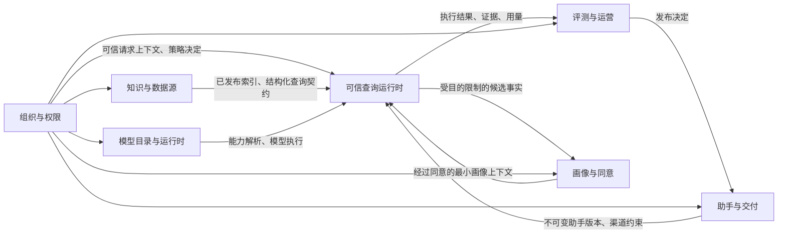

# 可信 RAG 基座领域设计

## 1. 设计边界

新系统采用绿地建设，不以旧接口、旧数据库、旧配置或旧页面为兼容边界。领域模型只表达通用企业 AI 平台能力，门店、商品、高校和图书馆均作为租户配置、数据集结构、知识空间和助手版本出现，不进入核心领域类型。

领域层只依赖 JDK。Spring Boot、Spring AI、Sa-Token、MyBatis-Plus、Hutool、数据库、消息和网络协议都位于领域边界之外。

## 2. 统一语言

| 术语 | 含义 | 明确排除 |
| --- | --- | --- |
| 租户 | 数据、策略、配额和用量的最高隔离边界 | 部门、门店或校园 |
| 组织单元 | 租户内部用于授权和归属的层级节点 | 独立租户 |
| 数据源 | 外部数据的连接、所有权、同步策略和安全声明 | 已发布知识 |
| 数据集结构 | 结构化字段、类型、查询能力、敏感级别和质量规则的版本化声明 | 任意 SQL |
| 知识空间 | 可授权、可发布、可被助手引用的知识边界 | 文件夹别名 |
| 索引版本 | 由固定内容版本、切片策略、嵌入模型和维度生成的不可变检索产物 | 可原地修改的向量集合 |
| 供应商连接 | 厂商、地址、区域、认证引用和网络策略的版本化连接 | 模型本身 |
| 模型部署 | 一个已经探测并声明能力、限制和价格的具体模型端点 | 厂商宣传能力 |
| 路由策略 | 在权限、驻留、能力、健康、延迟、成本和配额约束下选择模型的规则 | 隐式自动回退 |
| 助手版本 | 绑定知识、模型、行为、工具、渠道和策略的不可变发布单元 | 可直接修改的线上助手 |
| 查询任务 | 从受理到拒答、失败或完成的可追踪执行 | 单次模型调用 |
| 证据 | 带来源、版本、定位、授权决定和新鲜度的检索结果 | 仅有文本片段 |
| 引用 | 回答中的声明与一个或多个已授权证据之间的可验证关系 | 模型自行生成的链接 |
| 评测门禁 | 基于固定数据集和阈值作出的版本发布决定 | 人工印象 |
| 同意记录 | 用户对画像目的、范围、期限和撤回方式的明确授权 | 默认勾选 |

## 3. 上下文关系



跨上下文只能使用公开契约或领域事件。禁止读取其他上下文的表、调用内部应用服务或共享持久化实体。

## 4. 组织与权限

### 4.1 聚合

**租户**

- 维护租户状态、数据驻留区域、默认安全上限和资源配额。
- 停用租户必须阻止新会话、新查询、新同步和模型调用。

**成员**

- 维护主体、组织单元、角色、有效期和状态。
- 一个主体在不同租户中的身份和授权完全独立。

**访问策略**

- 维护资源范围、操作、条件、行过滤、字段遮蔽和策略版本。
- 已发布策略不可修改，变更产生新版本。

**凭据**

- 维护人员、服务或设备凭据的标识、范围、有效期和撤销状态。
- 领域只保存密钥引用或不可逆摘要，不保存可恢复明文。

### 4.2 不变量

- 所有受保护请求必须携带租户、主体、凭据类型、渠道和追踪标识。
- 资源授权、行过滤和字段遮蔽属于同一个策略决定。
- 策略变化必须使相关会话、授权缓存和流式查询失效。
- 无权限结果不得泄漏资源是否存在。
- 平台运营权限不能隐式获得租户内容读取权限。

### 4.3 公开契约

- `TrustedRequestContext`
- `AuthorizationRequest`
- `PolicyDecision`
- `ResourceScope`
- `DataFilter`
- `FieldMask`
- `CredentialRevoked`
- `PolicyPublished`

## 5. 知识与数据源

### 5.1 聚合

**数据源**

- 定义类型、负责人、连接引用、同步策略、敏感级别和状态。
- 探测成功只代表可连接，不代表允许发布。

**数据集结构**

- 定义字段、类型、主键、可过滤字段、可排序字段、敏感级别、单位、时区和质量规则。
- 发布后不可修改；字段含义改变时必须产生新版本。

**知识空间**

- 定义可授权的内容边界、负责人、来源和已发布索引。
- 只允许绑定已通过质量校验的内容与索引版本。

**同步任务**

- 记录输入游标、产物摘要、成功、失败、重复、过期和越权计数。
- 重试同一幂等键不能生成重复发布产物。

**索引版本**

- 固定内容版本、切片策略、嵌入模型部署、维度、向量存储和构建摘要。
- 嵌入模型、维度或切片语义变化必须创建新索引版本。

### 5.2 不变量

- 摄取、校验、构建和发布是不同动作。
- 首次同步和后续同步都不能自动发布。
- 查询只读取已发布版本。
- 同一索引版本不得混用嵌入模型或维度。
- 删除源数据后，相关索引、缓存、引用和审计保留策略必须可证明执行。
- 结构化数据只能通过已发布的数据集结构和受控查询语言访问。

### 5.3 公开契约

- `PublishedKnowledgeSpace`
- `PublishedIndexVersion`
- `DatasetQueryContract`
- `ContentLocator`
- `DataFreshness`
- `KnowledgePublished`
- `IndexPublished`
- `SourceRetired`

## 6. 模型目录与运行时

### 6.1 供应商连接

字段包括：

- `tenantId`
- `providerKind`
- `endpoint`
- `region`
- `authenticationType`
- `credentialReference`
- `networkPolicy`
- `connectionStatus`
- `revision`

只有 DNS、TLS、认证和最小调用探测成功的版本才能进入就绪状态。

### 6.2 模型部署

字段包括：

- `providerConnectionId`
- `modelCode`
- `displayName`
- `modelType`
- `capabilityProfile`
- `contextWindow`
- `outputLimit`
- `supportedModalities`
- `portableOptions`
- `providerOptions`
- `pricing`
- `dataResidency`
- `status`
- `revision`

能力来自协议探测、受控配置和契约测试，不根据厂商名称推测。

### 6.3 模型路由策略

字段包括：

- `useCase`
- `requiredCapabilities`
- `primaryDeployment`
- `fallbackDeployments`
- `latencyBudget`
- `costBudget`
- `residencyConstraints`
- `healthConstraints`
- `fallbackRules`

回退必须显式授权。区域、结构化输出、工具、内容安全、嵌入维度或租户授权不满足时必须拒绝，而不是静默降级。

### 6.4 模型能力

统一描述：

- 流式输出
- 工具调用
- 结构化输出
- 视觉输入
- 音频输入
- JSON Schema
- 对话记忆兼容性
- 最大上下文
- 最大输出
- 嵌入维度
- 批量嵌入
- 内容安全类别
- 用量元数据
- 推理选项

### 6.5 公开契约

- `ModelRequirement`
- `ModelCapabilityProfile`
- `ResolvedModelRoute`
- `ModelInvocation`
- `ModelInvocationResult`
- `ProviderConnectionProbed`
- `ModelDeploymentPublished`
- `RoutingPolicyPublished`

公开契约不得出现 Spring AI 类型或厂商专属参数对象。

## 7. 助手与交付

### 7.1 聚合

**助手**

- 维护身份、负责人、用途和草稿指针。
- 不能直接承载线上可变配置。

**助手版本**

- 固定知识空间与索引范围、模型能力要求、路由策略、行为策略、记忆策略、工具、渠道、配额和评测门禁。
- 发布后不可修改。

**渠道绑定**

- 把一个已发布助手版本绑定到网页、API 或设备凭据范围。
- 渠道只能进一步收窄权限、配额和数据范围，不能扩大助手版本权限。

### 7.2 不变量

- 未通过评测门禁的版本不得发布。
- 未发布的数据、模型部署、路由策略或工具不得被线上助手引用。
- 设备凭据只允许访问固定租户、助手版本、门店或组织单元范围。
- 渠道变更必须产生审计记录，撤销应即时生效。

### 7.3 公开契约

- `PublishedAssistantVersion`
- `ChannelContext`
- `AssistantReleased`
- `ChannelBound`
- `ChannelRevoked`

## 8. 可信查询运行时

### 8.1 查询任务聚合

查询任务记录：

- 可信请求上下文。
- 助手、策略、索引、模型和配置版本。
- 查询分类与查询计划。
- 检索候选、授权决定、重排结果和最终证据。
- 模型调用、回退原因、Token、费用和延迟。
- 回答、引用校验、拒答或失败原因。
- 单调递增事件序号。

状态只能按以下方向变化：

```text
已接受
  -> 规划中
  -> 检索中
  -> 生成中
  -> 已完成

任一非终止状态
  -> 已拒答
  -> 无权限
  -> 失败
  -> 已取消
```

### 8.2 核心值对象

- `TrustedRequestContext`
- `PolicyDecision`
- `QueryIntent`
- `QueryPlan`
- `StructuredQuery`
- `RetrievalCandidate`
- `AuthorizedEvidence`
- `GroundedAnswer`
- `VerifiedCitation`
- `UsageRecord`

### 8.3 不变量

- 权限过滤必须发生在检索前，证据必须在生成前再次鉴权。
- 生成只能接收已授权证据和允许字段。
- 结构化查询只能使用受控查询语言，不允许模型生成并执行任意 SQL。
- 引用无法验证时必须删除相关声明、降级为不确定回答或拒答。
- 流式输出仍须遵守取消、撤权、配额和最终对账。
- 查询必须记录实际使用的所有版本，保证评测和审计可重放。

## 9. 评测与运营

### 9.1 聚合

**评测数据集**

- 维护问题、期望证据、允许答案、拒答期望、权限场景和版本。

**评测任务**

- 固定助手版本、数据版本、模型路由、策略版本和指标实现版本。
- 运行结果不可被后续配置覆盖。

**发布门禁**

- 定义检索、事实依据、引用、拒答、安全、延迟和成本阈值。

**发布决定**

- 记录通过、拒绝、例外、批准人、理由和证据。
- 例外必须有期限和补救工作包。

### 9.2 不变量

- 不能使用与被测版本不同的数据、策略或模型结果签署发布。
- 指标计算失败时不能按通过处理。
- 质量下降超过阈值时必须阻止发布或触发回滚决定。

## 10. 画像与同意

### 10.1 聚合

**同意记录**

- 定义主体、目的、数据类别、渠道、有效期、撤回方式和版本。

**画像**

- 只保存与已同意目的有关、可追踪来源、可过期和可删除的事实。
- 推断事实与用户明确提供的事实必须区分。

### 10.2 不变量

- 没有有效同意不得建立或使用个人画像。
- 画像不能成为扩大知识访问权限的依据。
- 撤回后必须停止新写入，并按策略删除或匿名化历史数据。
- 演示环境默认关闭个人画像，只使用合成主体。

## 11. 事务、事件与一致性

- 聚合根是本地事务边界。
- 跨上下文更新通过带事务发件箱的领域事件传播。
- 发件箱记录与聚合变更同事务提交。
- 消费者必须按事件标识幂等，并记录处理版本。
- 事件至少一次投递；业务语义通过幂等和版本检查实现一次效果。
- 不使用跨数据库分布式事务。

事件信封至少包含：

```json
{
  "eventId": "evt_...",
  "eventType": "KnowledgePublished",
  "schemaVersion": 1,
  "tenantId": "ten_...",
  "aggregateId": "ksp_...",
  "aggregateVersion": 7,
  "occurredAt": "2026-07-26T10:00:00Z",
  "traceId": "trc_...",
  "payload": {}
}
```

## 12. 失败与补偿

| 失败 | 领域结果 | 补偿或恢复 |
| --- | --- | --- |
| 数据源探测失败 | 保持草稿或失败，不创建发布版本 | 修正连接后重新探测 |
| 同步部分成功 | 产物隔离，不自动发布 | 查看失败记录后重试或放弃 |
| 索引构建失败 | 保留上一已发布版本 | 修复后构建新版本 |
| 模型主路由不可用 | 依据显式策略回退或拒绝 | 恢复健康后自动重新参与路由 |
| 权限在流式期间撤销 | 终止后续证据和工具访问 | 记录终止事件并完成用量对账 |
| 引用校验失败 | 删除声明、标记不确定或拒答 | 进入评测失败分类 |
| 审计写入暂时失败 | 查询结果进入受控待确认状态 | 发件箱重试；超过窗口触发告警 |

## 13. 架构适配规则

- Spring Modulith 校验上下文依赖和内部包访问。
- ArchUnit 校验领域层只依赖 JDK。
- 每个公开契约都有契约测试。
- 每个聚合不变量都有领域测试。
- 任何跨上下文数据库访问、共享持久化实体或框架类型泄漏都阻止合并。
