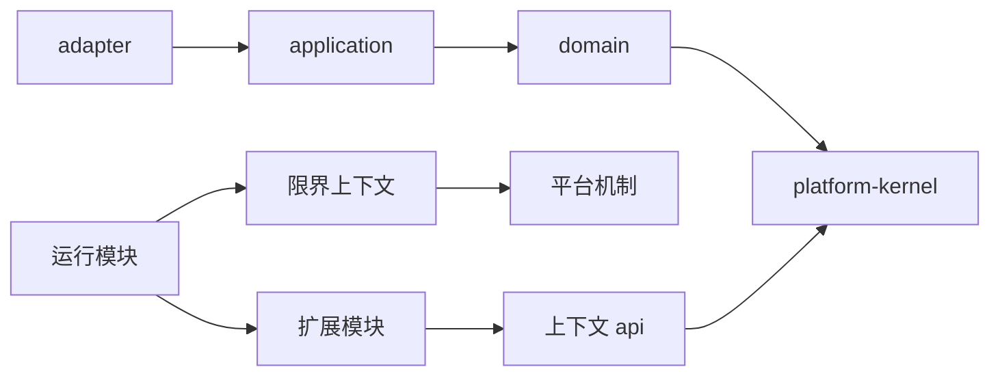

# 可信 RAG 基座详细目录规划

## 1. 目标

目录结构必须同时解决：

- 领域所有权清晰。
- 框架与厂商变化局部化。
- 三个运行进程可以独立装配和扩缩容。
- 前端控制台、问答和设备界面互不污染。
- 公共契约能够被后端、前端、测试和外部调用方共同验证。
- 数据库、缓存、对象存储和事件具有明确负责人。
- 一周演示只创建必要目录，长期扩展不需要推翻根结构。

目录不是功能菜单，也不是把每个类放进一个新模块。只有独立所有权、依赖方向、发布产物或变化频率形成真实边界时才建立模块。

## 2. 方案比较

| 维度 | 每上下文单模块 | 每层独立模块 | 选定混合方案 |
| --- | --- | --- | --- |
| Maven 模块数 | 低 | 很高 | 中 |
| 领域编译隔离 | 依赖架构测试 | 最强 | 核心靠规则，外部依赖靠模块 |
| 纵向功能修改 | 局部 | 容易跨多个模块 | 局部 |
| 厂商依赖隔离 | 较弱 | 强 | 强 |
| 三进程选择性装配 | 中 | 强 | 强 |
| 六人团队维护成本 | 低 | 高 | 可控 |
| 新增供应商成本 | 可能污染上下文 | 新增模块 | 新增扩展模块 |
| Spring Modulith 适配 | 好 | 较弱 | 好 |

最终采用：

```text
限界上下文 = 默认一个 Maven 模块
高变化外部能力 = 一个独立扩展模块
可部署进程 = 一个独立运行模块
跨语言公共契约 = 根 contracts/
跨运行时验证 = 根 verification/
```

## 3. 规划后的仓库根目录

```text
ai-platform/
├── AGENTS.md
├── README.md
├── Makefile
├── pom.xml
├── mvnw
├── mvnw.cmd
├── .mvn/
│   ├── wrapper/
│   └── maven.config
├── backend/
│   ├── pom.xml
│   ├── platform/
│   ├── contexts/
│   ├── extensions/
│   ├── runtimes/
│   ├── test-support/
│   └── architecture-tests/
├── frontend/
│   ├── package.json
│   ├── package-lock.json
│   ├── tsconfig.base.json
│   ├── eslint.config.js
│   ├── apps/
│   ├── packages/
│   └── e2e/
├── contracts/
│   ├── http/
│   ├── events/
│   ├── schemas/
│   ├── query-dsl/
│   └── examples/
├── deploy/
│   ├── compose/
│   ├── images/
│   ├── config/
│   ├── postgres/
│   ├── observability/
│   ├── scripts/
│   └── runbooks/
├── verification/
│   ├── acceptance/
│   ├── contract/
│   ├── evaluation/
│   ├── security/
│   ├── performance/
│   ├── resilience/
│   └── fixtures/
├── docs/
│   ├── adr/
│   ├── product/
│   ├── design/
│   ├── architecture/
│   ├── security/
│   ├── testing/
│   ├── operations/
│   └── planning/
├── project/
│   ├── work-packages/
│   └── evidence/
├── scripts/
│   ├── project/
│   ├── quality/
│   ├── development/
│   └── release/
└── tools/
    ├── contract-codegen/
    └── fixture-builder/
```

这是最终逻辑结构，不代表 M1 第一天创建全部空目录。目录只有在对应工作包产生真实源码、配置或测试时才落地。

## 4. 根目录职责

| 路径 | 唯一职责 | 禁止内容 |
| --- | --- | --- |
| `backend/` | Java 领域、应用、适配器、扩展和运行入口 | 前端、部署脚本、人工文档 |
| `frontend/` | React 应用、共享界面包和浏览器测试 | 后端领域规则、手写接口副本 |
| `contracts/` | 跨语言和外部公共契约源文件 | 领域实体、数据库结构、框架类 |
| `deploy/` | Docker 构建、Compose、配置模板和运行手册 | 业务初始化数据、明文密钥 |
| `verification/` | 跨模块和跨进程的产品级验证 | 生产业务代码 |
| `docs/` | 产品、设计、架构、安全、测试和运维说明 | 项目当前状态 |
| `project/` | 目标、前沿、工作包、风险、决策索引和证据 | 详细技术设计副本 |
| `scripts/` | 短小、可组合的仓库任务入口 | 长期业务逻辑和通用库 |
| `tools/` | 可测试、可版本化的开发工具 | 线上运行逻辑 |

## 5. 后端 Maven 反应堆

```text
backend/
├── pom.xml
├── platform/
│   ├── platform-kernel/
│   ├── platform-web/
│   ├── platform-security/
│   ├── platform-persistence/
│   ├── platform-observability/
│   └── platform-outbox/
├── contexts/
│   ├── organization-access/
│   ├── knowledge-data/
│   ├── model-runtime/
│   ├── assistant-delivery/
│   ├── trusted-query/
│   ├── evaluation-operations/
│   └── profile-consent/
├── extensions/
│   ├── model-providers/
│   ├── data-connectors/
│   ├── vector-stores/
│   ├── object-stores/
│   ├── secret-stores/
│   ├── delivery-channels/
│   └── tool-providers/
├── runtimes/
│   ├── control-plane/
│   ├── query-runtime/
│   └── ingestion-worker/
├── test-support/
└── architecture-tests/
```

根 `pom.xml` 只负责：

- 模块聚合。
- 统一插件和依赖版本。
- Maven Enforcer。
- 可重复构建。
- SBOM、SCA 和许可证门禁。

根 POM 不声明业务依赖。具体依赖在最靠近使用方的模块中声明。

## 6. 平台机制模块

### 6.1 `platform-kernel`

只依赖 JDK，允许包含：

- 不透明标识基础类型。
- 时钟、版本和结果等无业务语义基础契约。
- 领域事件信封的最小接口。
- 幂等键、追踪标识等稳定值对象。

禁止包含：

- 租户权限规则。
- 模型、知识、助手或查询概念。
- `StringUtils`、`BeanUtils` 等工具集合。
- Spring、Hutool、MyBatis-Plus 或 Sa-Token 类型。

### 6.2 `platform-web`

- HTTP 错误信封。
- 游标分页协议。
- 幂等请求过滤与接口适配。
- SSE 连接、事件序号和恢复协议。
- 输入大小、媒体类型和统一安全响应。

### 6.3 `platform-security`

- Sa-Token 到可信请求上下文的适配。
- 出站地址安全策略。
- 脱敏、日志敏感字段策略。
- 认证入口的通用机制。

领域授权策略仍归 `organization-access`，不能放到平台安全模块。

### 6.4 `platform-persistence`

- MyBatis-Plus 安全配置。
- 租户条件纵深防御。
- 数据库类型转换和统一事务适配。
- 游标编码与数据库分页基础能力。

禁止共享业务持久化实体、Mapper 或跨上下文查询。

### 6.5 `platform-observability`

- Micrometer、追踪和日志关联。
- 统一低基数标签。
- 指标命名与敏感内容排除规则。

### 6.6 `platform-outbox`

- 事务发件箱基础记录。
- 幂等消费收据。
- 调度、重试和死信机制。

事件内容、事件类型和补偿规则归事件所有上下文。

建立新平台模块必须同时满足：

1. 至少三个真实上下文消费者。
2. 不包含任何领域规则。
3. 有明确负责人和契约测试。
4. 无法通过 JDK、Spring 或现有模块清晰解决。

禁止创建 `platform-common`、`platform-shared`、`utils` 或 `helpers`。

## 7. 限界上下文标准模板

每个上下文使用同一外部形状：

```text
backend/contexts/<context>/
├── pom.xml
└── src/
    ├── main/
    │   ├── java/com/aiplatform/foundation/<context>/
    │   │   ├── package-info.java
    │   │   ├── api/
    │   │   │   ├── command/
    │   │   │   ├── query/
    │   │   │   ├── event/
    │   │   │   └── model/
    │   │   ├── domain/
    │   │   │   ├── model/
    │   │   │   ├── policy/
    │   │   │   ├── service/
    │   │   │   ├── event/
    │   │   │   └── repository/
    │   │   ├── application/
    │   │   │   ├── command/
    │   │   │   ├── query/
    │   │   │   ├── service/
    │   │   │   ├── port/
    │   │   │   │   ├── in/
    │   │   │   │   └── out/
    │   │   │   └── result/
    │   │   └── adapter/
    │   │       ├── in/
    │   │       │   ├── web/
    │   │       │   └── event/
    │   │       └── out/
    │   │           ├── persistence/
    │   │           ├── cache/
    │   │           └── event/
    │   └── resources/
    │       ├── db/migration/<context>/
    │       └── META-INF/spring/
    └── test/
        ├── java/com/aiplatform/foundation/<context>/
        │   ├── domain/
        │   ├── application/
        │   ├── adapter/
        │   └── architecture/
        └── resources/
```

### 7.1 `api`

- 是上下文唯一公开命名接口。
- 包含跨上下文使用的命令、查询、结果和事件。
- 使用平台类型和 JDK 类型，不出现 Controller、Entity、Mapper 或 Spring AI 类型。
- 不包含内部聚合根和仓储。

### 7.2 `domain`

- 只依赖 JDK 和 `platform-kernel` 中经批准的基础类型。
- 聚合根位于 `model`，事务不变量由聚合维护。
- `policy` 表达需要多个领域对象协作的纯规则。
- `service` 只放无法自然属于聚合的领域行为。
- `repository` 是领域需要的持久化抽象，不出现 MyBatis 类型。

### 7.3 `application`

- 编排用例、事务、权限决定和领域事件。
- `command` 与 `query` 分开，避免一个万能服务。
- 入站端口表达用例，出站端口表达外部依赖。
- 不返回持久化实体和框架类型。

### 7.4 `adapter`

- `in/web` 只负责 HTTP、校验、身份上下文和契约映射。
- `in/event` 只负责事件反序列化、幂等和调用应用用例。
- `out/persistence` 包含持久化实体、Mapper、转换器和仓储实现。
- `out/cache` 包含 Key、TTL、失效和降级实现。
- `out/event` 把领域事件写入发件箱或发布端口。

### 7.5 禁止的目录

- `common`
- `utils`
- `manager`
- `helper`
- `service/impl`
- `entity` 与领域模型混放
- 按 Controller、Service、Mapper 横向堆叠整个上下文

如果一个类无法放入模板，应先检查它是否跨越了多个职责，而不是创建新杂项目录。

## 8. 上下文具体子域

### 8.1 `organization-access`

```text
domain/
├── tenant/
├── organization/
├── membership/
├── policy/
└── credential/
```

适配器包括人员认证、服务凭据、设备凭据、Sa-Token 和策略持久化。

### 8.2 `knowledge-data`

```text
domain/
├── datasource/
├── datasetschema/
├── knowledgespace/
├── syncrun/
└── indexversion/
```

文件解析器、数据库连接器、对象存储和向量存储不进入该上下文核心，分别通过扩展模块实现。

### 8.3 `model-runtime`

```text
domain/
├── providerconnection/
├── modeldeployment/
├── capability/
├── routing/
├── pricing/
└── health/
application/
├── catalog/
├── probe/
├── routing/
├── invocation/
└── usage/
api/
├── catalog/
├── routing/
├── invocation/
└── extension/
```

`api/extension` 定义按模型类型拆分的编译期扩展接口。Spring AI 类型只能出现在模型厂商扩展内部。

### 8.4 `assistant-delivery`

```text
domain/
├── assistant/
├── version/
├── release/
└── channelbinding/
```

网页、API 和硬件协议通过渠道扩展实现，不把门店或校园写进聚合。

### 8.5 `trusted-query`

```text
domain/
├── queryrun/
├── planning/
├── evidence/
├── citation/
└── refusal/
application/
├── pipeline/
├── retrieval/
├── generation/
├── streaming/
└── reconciliation/
```

Advisor 顺序在 `application/pipeline` 固定，不能按厂商或页面建立分支。

### 8.6 `evaluation-operations`

```text
domain/
├── dataset/
├── run/
├── metric/
├── releasegate/
├── audit/
└── usage/
```

如果审计和用量以后出现独立容量、合规和所有权证据，再通过 ADR 拆出新上下文。

### 8.7 `profile-consent`

```text
domain/
├── consent/
├── profile/
├── purpose/
└── retention/
```

M1 不创建该模块，直到画像与同意工作包进入当前前沿。

## 9. 扩展模块

扩展模块是编译期插件，不支持运行时上传任意 JAR。

```text
backend/extensions/
├── model-providers/
│   ├── provider-openai-compatible/
│   ├── provider-ollama/
│   ├── provider-openai/
│   ├── provider-azure-openai/
│   ├── provider-anthropic/
│   ├── provider-vertex-gemini/
│   ├── provider-bedrock/
│   └── provider-mistral/
├── data-connectors/
│   ├── connector-file/
│   ├── connector-jdbc/
│   ├── connector-s3/
│   └── connector-http/
├── vector-stores/
│   ├── vector-pgvector/
│   └── vector-redis/
├── object-stores/
│   ├── object-s3/
│   └── object-minio/
├── secret-stores/
│   ├── secret-vault/
│   └── secret-local-development/
├── delivery-channels/
│   ├── channel-web/
│   ├── channel-api/
│   └── channel-device/
└── tool-providers/
    ├── tool-mcp-client/
    └── tool-managed-http/
```

每个扩展模块标准结构：

```text
<extension>/
├── pom.xml
└── src/
    ├── main/
    │   ├── java/
    │   │   ├── configuration/
    │   │   ├── adapter/
    │   │   ├── mapping/
    │   │   ├── error/
    │   │   └── telemetry/
    │   └── resources/META-INF/spring/
    └── test/
        ├── java/
        │   ├── contract/
        │   ├── protocol/
        │   ├── security/
        │   └── redaction/
        └── resources/
```

扩展模块规则：

- 依赖对应上下文公开扩展接口，不依赖领域内部包。
- 厂商配置、错误映射和专属参数只留在扩展模块。
- 一个模型厂商可以实现多个按模型类型拆分的工厂，但不能引入巨型万能接口。
- 新增扩展必须通过统一契约测试。
- 运行模块通过显式 Maven 依赖选择允许装配的扩展。

## 10. 三个运行模块

### 10.1 `control-plane`

```text
runtimes/control-plane/
├── pom.xml
└── src/
    ├── main/
    │   ├── java/.../controlplane/
    │   │   ├── ControlPlaneApplication.java
    │   │   ├── configuration/
    │   │   └── health/
    │   └── resources/
    │       ├── application.yml
    │       └── application-local.yml
    └── test/
```

装配：

- 组织与权限。
- 知识和数据控制面。
- 模型目录。
- 助手设计与发布。
- 评测、审计、用量和运维接口。

不装配在线生成入口和重型摄取执行器。

### 10.2 `query-runtime`

装配：

- 可信请求认证。
- 助手发布版本读取。
- 策略和配额。
- 可信查询流水线。
- 模型路由和允许的供应商扩展。
- 向量、结构化查询和渠道扩展。
- SSE、审计和计量。

不装配管理写接口和摄取调度。

### 10.3 `ingestion-worker`

装配：

- 数据源同步任务。
- 文件解析和数据连接器。
- 对象存储。
- Embedding 模型扩展。
- 向量存储。
- 索引构建、校验和发件箱消费。

不暴露终端用户查询接口。

### 10.4 运行模块规则

- 只包含启动类、配置、健康和装配测试。
- 不定义领域实体、仓储和业务规则。
- 配置使用类型安全属性。
- 每个运行模块拥有独立连接池、线程、超时和资源限制。
- 三个运行模块可以来自同一代码版本，但生成独立镜像。

## 11. 后端依赖方向



禁止方向：

- 领域依赖应用、适配器或 Spring。
- 上下文内部包被其他上下文引用。
- 扩展模块依赖上下文领域内部包。
- 平台机制依赖任一业务上下文。
- 运行模块包含业务规则。
- 一个厂商扩展依赖另一个厂商扩展。

## 12. 前端工作区

```text
frontend/
├── package.json
├── package-lock.json
├── tsconfig.base.json
├── eslint.config.js
├── apps/
│   ├── console-web/
│   ├── query-web/
│   └── device-web/
├── packages/
│   ├── design-system/
│   ├── api-client/
│   ├── auth/
│   ├── query-stream/
│   ├── telemetry/
│   ├── test-support/
│   └── build-config/
└── e2e/
    ├── console/
    ├── query/
    ├── device/
    └── fixtures/
```

使用 npm 工作区统一依赖锁。每个应用独立构建、测试和生成镜像。

### 12.1 `console-web`

```text
apps/console-web/
├── index.html
├── package.json
├── vite.config.ts
└── src/
    ├── main.tsx
    ├── app/
    │   ├── providers/
    │   ├── routing/
    │   ├── shells/
    │   └── error-boundary/
    ├── capabilities/
    │   ├── overview/
    │   ├── data-publishing/
    │   ├── model-governance/
    │   ├── assistant-release/
    │   ├── evaluation/
    │   ├── access-governance/
    │   └── operations/
    ├── shared/
    │   ├── formatting/
    │   ├── permissions/
    │   └── navigation/
    └── test/
```

每个能力切片使用：

```text
capabilities/<capability>/
├── routes/
├── pages/
├── components/
├── models/
├── api/
├── tests/
└── index.ts
```

`index.ts` 是能力切片唯一公开入口。页面按用户任务命名，不按后端 Controller 命名。

### 12.2 `query-web`

```text
apps/query-web/src/
├── app/
├── conversation/
├── answer/
├── citations/
├── feedback/
├── history/
└── access/
```

只面向提问、来源、反馈和会话，不包含管理功能。

### 12.3 `device-web`

```text
apps/device-web/src/
├── app/
├── session/
├── voice/
├── touch/
├── answer/
├── accessibility/
└── recovery/
```

M7 前不创建该应用。硬件厂商协议属于后端渠道扩展，设备网页只处理触控、语音和现场恢复。

## 13. 前端共享包

### 13.1 `design-system`

- FluentProvider、品牌令牌、主题和图标策略。
- 页面外壳、状态视图、发布确认和引用视图等至少被两个应用使用的组合组件。
- 不包装每一个 Fluent 基础组件。
- 不包含租户、模型和知识领域逻辑。

### 13.2 `api-client`

- 由 `contracts/http` 可重复生成的类型和调用客户端。
- 统一错误、游标、幂等和 traceId 处理。
- 生成目录不手工修改。

### 13.3 `auth`

- 登录状态、可信会话恢复和路由守卫。
- 不在浏览器推导资源授权。

### 13.4 `query-stream`

- SSE 连接、事件序号、重连、取消和最终对账。
- 控制台诊断和问答应用共同使用。

### 13.5 创建共享包的门槛

必须同时满足：

1. 至少两个真实应用消费。
2. 具有稳定公开接口。
3. 不包含单一页面业务逻辑。
4. 有独立单元测试和负责人。

否则代码保留在应用能力切片内。

## 14. 公共契约目录

```text
contracts/
├── http/
│   ├── control-plane/
│   │   ├── openapi.yaml
│   │   ├── organization-access.yaml
│   │   ├── knowledge-data.yaml
│   │   ├── model-runtime.yaml
│   │   ├── assistant-delivery.yaml
│   │   └── evaluation-operations.yaml
│   └── query-runtime/
│       ├── openapi.yaml
│       ├── query-runs.yaml
│       └── events.yaml
├── events/
│   ├── envelope.schema.json
│   ├── organization-access/
│   ├── knowledge-data/
│   ├── model-runtime/
│   ├── assistant-delivery/
│   └── evaluation-operations/
├── schemas/
│   ├── model-options/
│   ├── dataset-schema/
│   ├── evidence/
│   └── tool-input/
├── query-dsl/
│   ├── v1.schema.json
│   └── examples/
└── examples/
    ├── store/
    └── campus/
```

规则：

- HTTP 契约按运行入口拆分，再按上下文拆文件。
- 事件结构由事件所有上下文维护。
- 生成 Java 和 TypeScript 代码进入构建目录，不提交手工修改。
- 破坏性变化必须新增主版本、ADR 和工作包。
- 契约示例只能使用合成数据。

## 15. 数据库与存储所有权

### 15.1 数据库迁移

业务迁移靠近所属上下文：

```text
contexts/<context>/src/main/resources/db/migration/<context>/
├── V001__create_<aggregate>.sql
├── V002__add_<behavior>.sql
└── R__refresh_<projection>.sql
```

- 每张表只有一个上下文负责人。
- 禁止跨上下文外键和直接 Mapper 查询。
- 跨上下文读取使用公开查询、事件投影或专用读模型。
- 迁移不可修改已发布文件，只能追加。
- `deploy/postgres/` 只创建数据库、角色、扩展和最小权限，不创建业务表。

### 15.2 Redis

每个上下文定义自己的 Key 工厂和 TTL：

```text
<product>:<environment>:<tenant>:<context>:<resource>:<version>
```

- Key 构造位于所属适配器。
- 禁止模糊批量删除。
- 失效事件由数据所有者发布。
- Redis 不是授权、发布状态或用量结算的唯一事实来源。

### 15.3 对象存储

```text
<environment>/<tenant>/<context>/<resource>/<version>/<object>
```

原始文件、解析产物、评测产物和导出文件使用不同前缀和保留策略。

### 15.4 向量索引

```text
<environment>__<tenant>__<knowledge-space>__<index-version>
```

索引版本绑定嵌入模型、维度、切片策略和内容摘要，禁止在同一集合原地切换模型。

## 16. Docker 与部署目录

```text
deploy/
├── compose/
│   ├── compose.yaml
│   ├── compose.dependencies.yaml
│   ├── compose.observability.yaml
│   └── profiles/
│       ├── demo.env.example
│       └── development.env.example
├── images/
│   ├── control-plane.Dockerfile
│   ├── query-runtime.Dockerfile
│   ├── ingestion-worker.Dockerfile
│   ├── console-web.Dockerfile
│   └── query-web.Dockerfile
├── config/
│   ├── application/
│   ├── reverse-proxy/
│   └── telemetry/
├── postgres/
│   ├── bootstrap/
│   └── roles/
├── observability/
│   ├── dashboards/
│   ├── alerts/
│   └── collectors/
├── scripts/
│   ├── initialize.sh
│   ├── smoke.sh
│   ├── backup.sh
│   ├── restore.sh
│   └── verify.sh
└── runbooks/
    ├── deployment.md
    ├── rollback.md
    ├── backup-restore.md
    └── incident-response.md
```

规则：

- 一个运行模块对应一个 Dockerfile。
- 镜像使用多阶段构建和非 root 用户。
- Compose 只引用镜像、环境和健康检查，不嵌入初始化业务逻辑。
- `.env` 永不提交，示例文件不得含真实密钥。
- 演示、开发和验证通过 Compose Profile 区分，不复制整套文件。
- Kubernetes 或 Terraform 在有明确生产工作包前不创建目录。

## 17. 跨系统验证目录

```text
verification/
├── acceptance/
│   ├── store/
│   ├── campus/
│   └── demo/
├── contract/
│   ├── http/
│   ├── events/
│   ├── providers/
│   ├── connectors/
│   └── channels/
├── evaluation/
│   ├── datasets/
│   ├── metrics/
│   ├── baselines/
│   └── runners/
├── security/
│   ├── tenant-isolation/
│   ├── authorization/
│   ├── credentials/
│   ├── ssrf/
│   └── content-safety/
├── performance/
│   ├── query/
│   ├── ingestion/
│   ├── model-routing/
│   └── streaming/
├── resilience/
│   ├── model-failure/
│   ├── vector-store-failure/
│   ├── queue-backlog/
│   └── recovery/
└── fixtures/
    ├── store/
    ├── campus/
    ├── providers/
    └── files/
```

单元测试和上下文集成测试仍靠近源码。只有需要两个以上模块、进程或语言共同参与的验证进入根 `verification/`。

测试产物进入忽略目录，`project/evidence/` 只登记报告地址、摘要、提交和复现命令。

## 18. 文档、控制面、脚本和工具

### 18.1 `docs`

- `product`：用户、任务、闭环和产品指标。
- `design`：信息架构、页面、组件、状态和可访问性。
- `architecture`：领域、目录、接口、数据、运行时和安全设计。
- `security`：威胁模型、权限矩阵、密钥和隐私。
- `testing`：测试策略、评测方法和容量模型。
- `operations`：部署、观测、备份、恢复和故障处理。
- `planning`：跨里程碑交付方案。

### 18.2 `project`

只保存当前事实、决策索引、工作包、风险和证据，不复制设计正文。

### 18.3 `scripts`

- 每个脚本完成一个仓库动作。
- 默认不超过一个主要流程。
- 可复用复杂逻辑升级为 `tools/` 下的可测试工具。
- 脚本不读取或修改未声明的用户目录。

### 18.4 `tools`

- `contract-codegen`：统一生成 Java 和 TypeScript 公共契约。
- `fixture-builder`：从合成定义生成门店和校园测试数据。

工具必须有自己的测试和版本，不得成为绕过 Maven 或前端构建的第二套构建系统。

## 19. 依赖矩阵

| 调用方 | 可依赖 | 禁止依赖 |
| --- | --- | --- |
| 上下文 `domain` | JDK、批准的 `platform-kernel` | Spring、Hutool、MyBatis-Plus、Sa-Token、Spring AI |
| 上下文 `application` | 本上下文 domain、api、端口 | Controller、Mapper、厂商 SDK |
| 上下文 `adapter` | 本上下文 application、domain、api、平台机制 | 其他上下文内部包 |
| 其他上下文 | 目标上下文 `api` 命名接口 | 目标上下文 domain、application、adapter |
| 扩展模块 | 对应扩展接口、平台机制、厂商 SDK | 核心领域内部包、其他扩展 |
| 运行模块 | 上下文、扩展、配置 | 业务规则 |
| 前端应用 | 共享包、自己的能力切片 | 其他应用内部源码 |
| 前端共享包 | 第三方库和自身公开依赖 | 单一应用页面与领域状态 |
| 验证 | 公共接口、部署地址、测试支持 | 生产内部快捷入口 |

## 20. 命名规则

### 20.1 Maven

- 平台：`foundation-platform-<mechanism>`
- 上下文：`foundation-context-<context>`
- 扩展：`foundation-extension-<kind>-<name>`
- 运行入口：`foundation-runtime-<name>`
- 测试支持：`foundation-test-support`

### 20.2 Java 包

```text
com.<organization>.foundation.<context>.<layer>
com.<organization>.foundation.extension.<kind>.<name>
com.<organization>.foundation.runtime.<name>
```

包名使用完整领域含义，不使用 `misc`、`base` 或 `general`。

### 20.3 前端

- 应用目录使用短横线命名。
- React 组件使用 PascalCase。
- 能力公开入口固定为 `index.ts`。
- 路由文件以用户任务命名。
- 测试靠近行为，文件名使用 `.test.ts`、`.test.tsx` 或 `.spec.ts`。

### 20.4 数据

- 表名以上下文缩写开头。
- 事件类型使用过去时业务事实。
- API 资源使用复数名词。
- Redis Key 和对象存储路径使用稳定、不可猜测的资源标识。

## 21. 生成文件与构建产物

不提交：

- Maven `target/`。
- 前端 `node_modules/`、`dist/` 和覆盖率报告。
- OpenAPI 生成客户端。
- 测试报告和性能原始数据。
- 本地 `.env`、密钥、IDE 状态和运行日志。

允许提交：

- 生成器配置。
- 契约源文件。
- 锁文件。
- 可复现的合成数据定义。
- 小型、稳定且经评审的黄金集。

CI 必须从干净检出重新生成并比较关键契约产物，防止本地生成结果漂移。

## 22. 目录所有权

| 范围 | 主负责人 | 必要评审 |
| --- | --- | --- |
| `project/`、`docs/product/` | 产品 | 受影响角色 |
| `docs/design/`、`frontend/packages/design-system/` | 设计 | 前端、产品 |
| `frontend/` | 前端 | 设计、测试 |
| `backend/contexts/` | 后端 | 测试、领域负责人 |
| `backend/extensions/` | 后端 | 安全、运维、测试 |
| `contracts/` | 接口所有上下文 | 前端、后端、测试 |
| `verification/` | 测试 | 对应实现负责人 |
| `deploy/`、`docs/operations/` | 运维 | 后端、测试、安全 |
| `docs/adr/` | 决策负责人 | 受影响角色 |

跨两个以上所有权边界的变化必须在工作包中列出共同评审人。

## 23. M1 最小落地目录

一周演示只创建：

```text
backend/platform/
backend/contexts/
├── organization-access/
├── knowledge-data/
├── model-runtime/
├── assistant-delivery/
├── trusted-query/
└── evaluation-operations/
backend/extensions/
├── model-providers/provider-openai-compatible/
├── model-providers/provider-ollama/
├── data-connectors/connector-file/
├── data-connectors/connector-jdbc/
├── vector-stores/vector-pgvector/
├── object-stores/object-minio/
└── secret-stores/secret-local-development/
backend/runtimes/
├── control-plane/
├── query-runtime/
└── ingestion-worker/
frontend/apps/
├── console-web/
└── query-web/
frontend/packages/
├── design-system/
├── api-client/
├── auth/
├── query-stream/
└── test-support/
contracts/
deploy/
verification/
```

M1 不创建：

- `profile-consent`。
- `device-web`。
- 未实现的模型厂商目录。
- 未使用的连接器、渠道和工具目录。
- Kubernetes、Terraform 和微服务目录。

## 24. 扩展场景

### 24.1 新增模型厂商

只允许改变：

1. 新增 `backend/extensions/model-providers/provider-<name>/`。
2. 增加统一厂商契约测试。
3. 在需要使用该厂商的运行模块中增加 Maven 依赖。
4. 在部署配置中增加允许的密钥引用。

如果必须修改助手、查询或评测领域契约，说明现有扩展接口不足，必须先形成 ADR。

### 24.2 新增数据连接器

新增一个连接器扩展，实现数据源探测、游标、读取、取消和错误分类契约。不得在 `knowledge-data` 中按连接器名称增加分支。

### 24.3 新增行业场景

新增：

- 合成或客户批准的数据集结构。
- 知识空间配置。
- 助手版本。
- 评测集。
- 渠道配置。

不得新增 `retail`、`university` 等核心领域模块，除非产品使命发生正式变化。

### 24.4 拆分独立服务

必须同时有：

- 独立容量或可用性目标。
- 清晰数据所有权。
- 可接受的一致性模型。
- 独立发布和运维负责人。
- 网络失败、重试、观测和成本证据。

否则继续保持模块化单体和独立运行入口。

## 25. 自动化门禁

实施阶段必须加入：

- Maven 模块依赖白名单。
- Spring Modulith 模块无环和命名接口验证。
- ArchUnit 领域 JDK 依赖、跨上下文内部包和适配器方向检查。
- 禁止 `common`、`utils`、`manager`、`service.impl` 目录。
- 扩展模块统一契约测试。
- OpenAPI 和事件契约破坏性变化检查。
- 前端应用不能导入其他应用源码。
- 前端共享包消费者数量检查。
- 数据库迁移所有权和重复版本检查。
- Docker 镜像与运行模块一一对应检查。
- 生成目录和密钥误提交检查。

## 26. 目录设计验收

目录设计通过必须证明：

- 任一新模型厂商、连接器、向量存储或渠道都有唯一新增位置。
- 任一领域规则都有唯一上下文和层。
- 任一公共接口都有所有者、版本和测试位置。
- 任一数据库表、Redis Key、对象路径和事件都有唯一负责人。
- 三个运行模块可以只装配所需能力。
- 前端三类界面不会互相导入内部页面。
- 单元、契约、验收、评测、安全、性能和故障测试各有明确位置。
- 没有为了未来猜测创建的空模块。
- M1 最小目录可以在一天内建立并通过架构测试。
