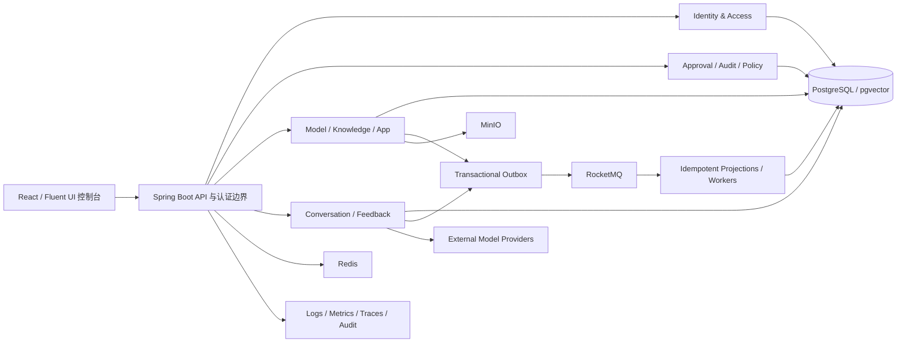

# 目标架构

状态：演进目标；每个阶段以实现与测试证据为准

## 架构目标

平台采用模块化单体业务核心 + 明确异步边界。目标不是增加层数，而是让租户安全、业务状态、版本引用、可靠事件和恢复操作成为少数高杠杆深模块，避免每个上下文重复实现脆弱逻辑。

## 不变量

1. 租户来自认证会话或可信消息 envelope；客户端 tenantId 只可作为资源定位输入，必须与主体租户再次校验。
2. 资源不可见返回 404，已知资源但缺动作权限返回 403，未认证返回 401。
3. 每个状态变化只有一个事务事实源；跨事务传播由 outbox 负责。
4. 发布对象不可变；运行时引用确定的 model、knowledge、app 与运行配置快照。
5. 所有外部调用有 timeout、错误分类、幂等/计费策略和可观察结果，不在长数据库事务中执行。
6. 异步任务有有限状态机、幂等键、重试预算、租约和人工恢复；数据库作业死信使用领域 API 重排，broker DLQ 只隔离传输失败并从 source outbox 受控重派发，不直接复制消息体。
7. 秘密只以引用或加密值存在，支持 key id 与轮换；API、事件、日志、错误不回显。
8. 高风险变化产生不可变审计，包含 actor、tenant、reason、traceId、before/after 和 result。

## 上下文与责任

| 上下文 | 核心责任 | 禁止承担 |
|---|---|---|
| identity-access | tenant、user、role、permission、session、invitation | 业务资源授权细节 |
| approval-center | 通用审批实例、步骤、决策与 SLA | 复制各领域完整对象 |
| observability-audit | 审计事实、查询、证据导出、运行关联 | 修改业务事实 |
| model-hub | provider、credential reference、model、usage policy、发布 | App/RAG 本地运行状态 |
| knowledge-base | document、ingest state、chunk/index version、retrieval policy | 模型供应商主数据 |
| app-studio | app draft/version、preflight、publish、runtime binding；内部 runtime 子边界负责 command/message、external call、result、citation、feedback | IAM 主数据、模型密钥或知识主数据 |
| summary-ops | 平台/租户任务摘要与运营读模型 | 修改来源上下文业务事实 |

审批决策属于职责分离边界：`approval-center` 聚合必须拒绝申请人对自身申请作出任何决策，表示层和验收流程不能用同一主体绕过四眼原则。

### 当前发布边界与未来扩展

本次发布只承认仓库中有真实 domain、API、权限、持久化、UI 与验收 seam 的七个业务上下文：identity-access、approval-center、observability-audit、model-hub、knowledge-base、app-studio、summary-ops。`prompt-center`、`tool-center`、`agent-center`、`workflow-engine`、`evaluation-center` 的空 POM、占位导航与目标态路由已从发布产品移除，不作为“完整平台”能力宣传。

未来若引入任一扩展上下文，必须先新增 ADR，冻结角色任务、领域边界、版本引用、权限、审计、失败恢复与 deploy 验收，再交付纵向切片；不得先创建空模块或可见菜单。应用中现有的系统指令等配置属于 app 版本快照，不冒充独立 Prompt 产品。

`app-studio runtime` 只是 `app-studio` 内部的运行子边界，不是第八个业务上下文。架构图、Maven reactor、权限前缀、导航和文档都必须维持同一个七上下文口径。

跨上下文同步只依赖 capability contract 或查询端口；禁止直接调用对方 application service。例外必须有 ADR、爆炸半径和测试。

## 目标深模块

下列名称描述需要统一的不变量与 seam，不声明仓库已经存在同名共享 class，也不要求为了“架构完整”提前抽取公共层。当前优先在所属上下文闭合行为；只有出现稳定重复且 codegraph impact 可控时才抽取共享实现。

- **AuthenticatedPrincipal**：一次性解析主体、租户、会话与权限，提供不可伪造的 request context。
- **RoutePermissionRegistry**：从控制器事实与显式配置校验 100% 路由覆盖。
- **VersionReferenceGraph**：统一不可变版本引用、被引用保护和影响查询。
- **TransactionalOutbox**：事务内记录事件，发布器按租约发送，consumer inbox/receipt 幂等；broker 提供按 group 重试与 DLQ 隔离，恢复从精确 source outbox 重派发同一 eventId。当前没有通用自动 replay API。
- **RecoverableJob**：统一 queued/running/retrying/cancelled/succeeded/failed 状态、租约、预算和人工恢复。
- **SecretEnvelope**：ciphertext、keyId、algorithm、createdAt；支持旧 key 解密和重加密。
- **ExternalCallPolicy**：timeout、retry eligibility、rate/cost budget、circuit state 和错误分类。
- **EvidenceEnvelope**：actor、tenant、resource、trace、source、version、result，供审计/引用/调试复用。

### 模型策略发布的 P4 纵向切片

- `model-hub` 的模型配置或审批状态变化与 `mdl_model_usage_policy_outbox` 入队共用 Spring `REQUIRED` 事务；业务路径不调用消息网关。
- 手工停用 provider 必须在同一事务中遍历其模型配置并写 usage-policy outbox，使 App/RAG 投影 fail-closed；停用理由在后端有界校验并写入高风险 audit detail，不能只在前端确认。
- 新发布的 outbox envelope 固定 `eventId`、`eventVersion=2`、`schemaVersion=schema/model-usage-policy.v2`，并携带 `modelConfigVersion`、`modelType` 与 `effectiveOptionsDigest` 的完整运行时 authority tuple；载荷只允许 secret reference 与 masked value，秘密型 options、URI user-info 和秘密型 query 参数失败关闭。历史 v1 行只为审计与迁移保留，消费者对 v1 失败关闭且不得写 receipt/投影，同一消费者必须能继续处理随后合法的 v2。每次策略写入从 PostgreSQL 全局序列取得持久化 `policyRevision`，并携带 `providerId` 与由数据库 canonical JSONB 函数计算的 SHA-256 `policyDigest`；时间戳不能充当顺序。
- dispatcher 使用 PostgreSQL `FOR UPDATE SKIP LOCKED` 原子 claim，记录 lease owner/expiry；只有 lease owner 能完成或退回任务，失败按有上限的指数退避回到 `PENDING`。
- RocketMQ/Spring Cloud Stream 只位于事务提交后的 dispatcher seam；网关返回未接受时视为失败，不把调用动作冒充投递成功。
- 五个 consumer binding 的应用内 `max-attempts` 固定为 1，失败交由 RocketMQ 原生 push consumer 执行有界 reconsume；`deploy/` 默认预算为 5、延迟级别为 3。预算耗尽按 consumer group 进入 `%DLQ%...`，不允许把 broker 消息体直接复制回主 topic；恢复边界见 [RocketMQ 领域事件诊断与受控恢复手册](../engineering/rocketmq-domain-event-recovery-runbook.md)。
- `app-studio` 与 `knowledge-base` 都在单个消费事务中先写各自的持久化 receipt，再更新本地投影；重复 `eventId` 无副作用，投影失败会回滚 receipt 以允许 broker 重试。投影只接受更高修订号；同修订同摘要幂等，同修订不同摘要失败关闭，旧事件不得靠较晚时间戳复活策略。
- `app-studio` 的应用主记录是草稿变更、ACL replacement、发布和回滚的共同串行化边界：命令事务先锁定 tenant-scoped 应用行，再重读授权与候选事实；create/update 的应用记录和知识库绑定同事务提交。应用目录使用有界窗口查询、绑定批量装配和活动版本批量装配，禁止逐应用查询；兼容窗口超限显式失败并审计，不静默截断。服务端投影同时给出不可拆分的 `accessMode/capabilities`，业务投影不携带可变模型、知识库或 Prompt 配置。
- 运行时策略不是秘密授权本身。App、知识问答和 Embedding 在创建任何客户端前，都用事件中的 tenant/provider/config/endpoint/auth/model/secret 引用重新核对 model-hub 当前权威事实；provider 必须 `ACTIVE`，配置必须 `ACTIVE + PASSED`，秘密必须当前有效且绑定同一 provider。`no_auth` 也必须完成全部身份核对后才能返回空凭据。
- 首次连通测试使用仅在 `model-hub` 内可见的独立 probe credential seam：它保持 tenant/provider/config/endpoint/auth/model/secret 精确绑定，但允许已经批准、尚未激活的 `INACTIVE + NOT_TESTED/FAILED` 配置完成测试；App、知识问答和 Embedding 不得依赖或访问该 seam。
- 升级迁移把现有 App/Knowledge 投影重新绑定到当前 provider/config/secret 权威事实，无法关联的投影删除，已停用或未通过连接验证的投影强制 `enabled=false`；这是一项经批准的 fail-closed 数据收缩。
- 该切片提供至少一次发送与持久化消费幂等。真实 RocketMQ 进程终止、网络分区、发布成功但 mark 前崩溃、lease 竞争及积压恢复仍必须在 deploy 环境执行 chaos 验收，当前单元/SQL 合同测试不替代这些证据。

## API 与错误

- API 版本显式，command 接受 clientRequestId 并对同一租户/操作幂等。
- 错误包含稳定 code、用户安全 message、traceId、可重试标志和字段问题；不包含堆栈、SQL 或供应商秘密。
- 分页、筛选、排序、日期和 money 格式统一；批量接口明确部分失败语义。
- OpenAPI 由实现生成并在 CI 比对，前端类型从固定契约生成或有等价契约测试。

## 数据与初始化

- 全新数据库的最终结构与基础数据事实源位于 `deploy/postgres/init/`，初始化失败即停止 backend 启动。
- 生产业务表显式 tenant_id、状态、版本、created/updated actor/time；唯一键含租户边界。
- 当前项目不提供历史 schema 升级链；结构变更直接维护最终 schema，并用空数据卷验收。
- seed 仅创建平台启动所需的基础元数据和 bootstrap 管理员，不写默认生产秘密，不创建业务样例。

## 运行与可观测性

- liveness 只表示进程存活；readiness 聚合关键依赖，RocketMQ 部分同时要求 Spring Cloud Stream `binders` 启动健康、至少一个 name-server 对只读 `GET_NAMESRV_CONFIG` 成功响应、至少一个 broker 对只读 `GET_BROKER_RUNTIME_INFO` 成功响应，Compose 使用该 readiness。只建立 TCP 连接不算健康；探针不发送或读取业务消息，consumer 连接、lag 与业务处理结果仍用无正文 connection/offset 和业务事实证据判断。
- traceId 从浏览器/API 贯穿 DB 业务记录、outbox、consumer 和外部模型调用。
- 目标指标至少覆盖请求、错误、延迟、连接池、outbox lag、consumer lag、任务状态、外部调用、token/成本和租户配额。当前 `deploy/` 未声明 RocketMQ Prometheus exporter 或自动告警规则，broker 证据暂以有界 `mqadmin` connection/offset 输出为准，不得把目标指标描述为已交付。
- 日志结构化、字段白名单、敏感值遮蔽；审计与运行日志职责分离。

## 演进顺序

先让 deploy、认证租户、事件和任务状态可靠，再按批准的 ADR 扩展新业务上下文；否则新能力会复制现有双写、恢复和权限缺陷。任何公共契约变更前用 codegraph impact 识别调用方，并通过兼容性测试分阶段迁移。

截至 2026-07-21，本文件描述目标与已进入工作树的结构，不构成运行验收：P5、P6、模型密钥轮换、RocketMQ 故障、性能、备份恢复和浏览器旅程都必须在最终候选 SHA 的 deploy 环境取得独立证据。
