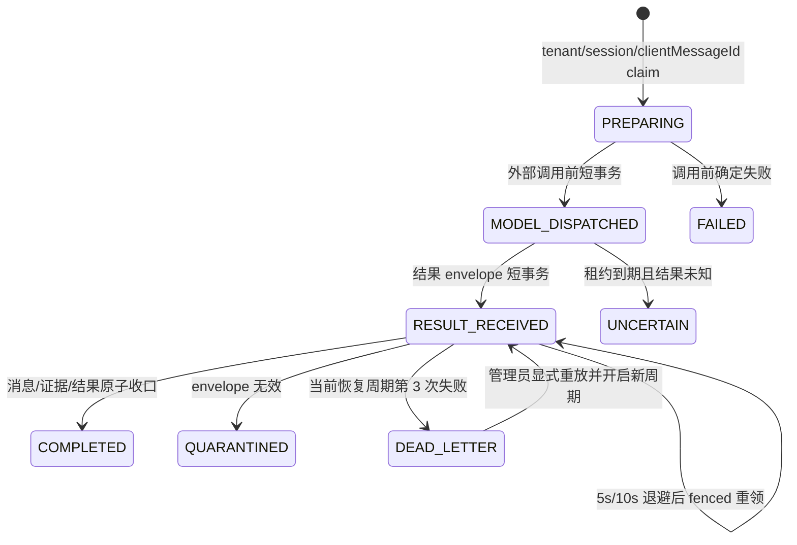

# 可恢复对话结果收口

状态：有界 retry/dead-letter/人工重放与路由权限为 `IMPLEMENTED_LOCAL`；最终候选 SHA 的 deploy chaos 证据为 `PENDING`
范围：`app-studio` 内部 runtime 子边界；不是独立业务上下文

## 用户结果与边界

- 同一租户、会话和 `clientMessageId` 只建立一个 durable run；重复命令返回已有状态或结果，不重新制造乐观消息。
- 外部检索和模型调用不在数据库事务中执行。模型调用前后只通过短事务推进 ownership、phase、lease 和 fence。
- 模型结果到达后先以显式 v1 finalization envelope 持久化为 `RESULT_RECEIVED`，再在独立短事务追加用户/助手消息、调试证据和完成结果。
- 进程在结果到达后崩溃时，scheduler 只重放已持久化的最终事务，不再次调用检索、策略或模型端口。
- `MODEL_DISPATCHED` 超时进入 `UNCERTAIN`，不能自动重放外部调用并冒险重复计费。

这些行为已进入当前工作树并有定向/App Studio 模块检查点，但未绑定最终 master 候选 SHA，也未通过完整 deploy 故障验收。

## 状态与 ownership

- 每次变更必须匹配 `tenant_id + run_id + lease_owner + fencing_token`；重领使 fence 单调增加，旧 worker 不能覆盖新 ownership。
- 恢复 claim 使用 PostgreSQL `FOR UPDATE SKIP LOCKED`，按租约到期时间和 run ID 稳定排序。
- 一个无效 envelope 在 adapter 中逐行转为 `QUARANTINED`，不回滚同批其他合法行；异常正文和 payload 不写日志。
- 初次收口计为当前周期第 1 次；失败后分别以 5 秒、10 秒退避进入第 2、3 次 fenced 尝试，第 3 次失败原子进入 `DEAD_LETTER`。失败记录暂时不可用时，批量恢复不会饿死其他行，租约到期后的有界 sweep 会把已耗尽行收敛为死信。
- `finalization_attempt_count` 在所有自动/人工周期中单调递增，`finalization_cycle_attempt_count` 仅在管理员开启新人工周期时重置为 1，避免通过重置总计数掩盖长期故障。
- 数据库触发器只在 SQL 未显式更新计数时补记首次结果/新 fence，且数据库约束把周期硬限制为 3；因此实例不能执行第 4 次 Tx B，后续由 sweep 收敛死信。显式计数时不会被重复增加。
- 死信保留并在查询/重放时重新校验 v1 finalization，但 GET API 只返回运行 ID、计数和固定安全失败摘要，不返回 finalization JSON、消息正文、prompt、凭据或人工原因。

## 人工重放与审计

- 查询：`GET /api/v1/chat-runs/dead-letters`；重放：`POST /api/v1/chat-runs/{runId}/dead-letter/replay`，请求必须包含不超过 128 字符的 `replayRequestId` 和不超过 512 字符的非空原因。
- GET 与 POST 路由都由 `application.yml` 精确要求 `app-studio:application:manage-acl`；应用层再要求调用者同时拥有 `app-studio:application:publish` 与 `app-studio:application:manage-acl`，任一权限缺失都在读取/claim 前失败关闭。定向 Controller—YAML 路由门禁已通过。
- claim 只能命中当前租户的 `DEAD_LETTER + RESULT_RECEIVED` 行，并在同一事务中写入 append-only `app_chat_run_replay_request` 与 HIGH 风险审计事件。审计失败会使 claim 事务失败。
- `(tenant_id, replay_request_id)` 唯一账本保证历史请求 ID 也幂等；同请求重复提交只返回当前持久化状态，不再次最终化或重复审计。不同请求并发时由行锁、状态谓词和新 fencing token 保证最多一个 claim 成功。
- 人工重放只执行已持久化 Tx B，绝不重新调用检索、策略或模型 provider。人工完成失败后回到同一有界自动恢复周期，仍可再次进入死信。

## 版本化持久化合同

`finalization_json` 与 `result_json` 都是最大 1 MiB 的显式 v1 envelope：

- finalization 必须包含数值 `schemaVersion=1`；数据库 `CHECK ... IS TRUE` 拒绝缺失、null、非 number 或未知版本，避免 SQL 三值逻辑放行。
- completed result 使用独立 `StoredCompletedResultV1`，不把 Java domain record 的字段布局当作数据库协议。
- decoder 对 finalization 拒绝未知字段；完成结果只从显式 envelope 读取。新版本必须做 expand/read-old-write-new/contract，不得就地改变 v1 含义。
- traceId 最大 64 字符；数据库 ID 必须是正整数语法；集合、metadata 数量和字符串长度有界；numeric/evidence/ownership 必须可解析且一致；NaN/Infinity 失败关闭。
- envelope 不包含拼接后的模型 prompt 或运行时凭据；完成后清除 `finalization_json`，只保留版本化 `result_json`。

## 事务与删除语义

最终事务按顺序追加用户消息、助手消息、调试快照并更新 run 为 `COMPLETED`；任一步失败都回滚本次最终事务。持久化 adapter 返回的消息 ID 必须与 envelope identity 一致，不能用请求临时 ID 代替数据库事实。

run 对 tenant/session/application/actor 使用复合外键。最终 deploy 必须证明会话、应用、用户或消息删除/停用时的真实数据库行为与产品保留策略一致，不能只依赖 fake repository 或迁移文本推断。

## 未关闭风险

| 风险 | 当前状态 | 退出条件 |
|---|---|---|
| 合法 payload 持续事务失败 | IMPLEMENTED_LOCAL | 最终 SHA deploy 注入持续失败，证明 3 次后死信、API 可查询、双权限重放与审计；运营 UI 另行验收 |
| Controller 统一权限入口 | IMPLEMENTED_LOCAL | 最终 SHA 重跑完整 DevelopmentRule，并在 deploy 以无权限/单权限/双权限主体核对 403 与成功路径 |
| 数据库引用被删除或变化 | PENDING | deploy PostgreSQL 注入删除/停用并验证 FK、404/409 和不产生孤儿结果 |
| 进程崩溃与并发 claim | PENDING | 结果持久化后 kill backend，多实例竞争只完成一次且不重复模型调用/计费 |
| 毒载荷隔离 | PENDING_DEPLOY | 同批 poison + valid 行，poison 被隔离且 valid 完成，日志零 payload/秘密 |
| 稳定重放结果 | PENDING_DEPLOY | 刷新/重复 `clientMessageId` 返回同一显式 v1 结果，未知版本失败关闭 |

## 最终验收

1. 只使用最终候选 SHA 构建的 deploy backend 和空卷初始化的 deploy PostgreSQL；初始化重跑不改写业务数据。
2. 并发十次同一 `clientMessageId` 只产生一个 run、一条用户消息、一个助手结果和一次可计费外部调用。
3. 在 `MODEL_DISPATCHED` 前、结果 envelope 提交后、消息追加中间和 run 完成前分别 kill 进程，核对状态、恢复次数、消息/证据和 provider 调用数。
4. 注入 trace 64/65、schema 缺失/null/未知、超限 payload、NaN/Infinity、identity 篡改与 poison batch；失败语义稳定且不泄密。
5. 注入连续三次 Tx B 失败，证明 5/10 秒退避后进入保留 v1 的死信；分别以缺 publish、缺 manage-acl、双权限三类主体验证失败关闭和成功重放，并核对租户隔离、唯一请求账本与审计。
6. 当前 App Studio 实现、最终数据库结构和定向 Controller—YAML DevelopmentRule 有局部检查点；这些不是最终候选 SHA 的 deploy chaos 签收证据，P6 仍保持未最终签收。
