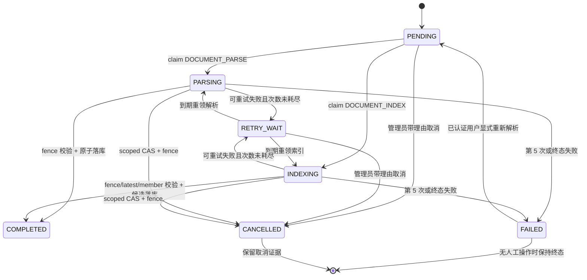

# 可恢复知识入库与索引重建

状态：实现合同与 `IMPLEMENTED_LOCAL` 检查点；知识库模块与临时 PostgreSQL 合同已重跑，完整 reactor、固定 SHA deploy 故障/容量验收仍为 `PENDING`

## 工作树实现结果与发布边界

- 上传成功返回文档 ID 与 durable 作业 ID；RocketMQ 不可用不会丢失已提交任务。
- 解析、Embedding、模型探测均不持有数据库长事务。
- 进程重启、消息丢失或 worker 崩溃后，PostgreSQL 轮询会重领到期租约。
- 旧 worker 的迟到结果因 lease token 与 version fence 不能覆盖新 worker。
- 当前租户的管理权限可带理由取消最新非终态作业；job/document 原子进入 `CANCELLED`，保存 actor/trace/time 并递增 fence，迟到 worker 不能覆盖。
- 切换 Embedding 模型时继续服务旧 active index；只有完整且仍是 latest generation 的候选才能一次性激活。
- 新增或改变的文档不进入已冻结 cohort；显式索引请求创建下一 generation。

上述结果已经进入当前工作树并有定向检查点，但不是固定 SHA 的发布承诺。长任务执行期间按租约三分之一周期 heartbeat；续租不改变 fence version，并同时匹配 tenant/job/owner/token/fence。object-first 提交失败会登记 durable 清理任务，宽限期后才核对活引用并执行租户路径受限的幂等删除。

## 状态机

第五次执行若在写回前崩溃，过期租约可被第六次“收尸 claim”认领；该 claim 不再调用外部系统，只将任务终结为 `FAILED`。数据库因此允许 `retry_count=6`，业务最大外部尝试仍为 5。

## 一致性边界

| 阶段 | 事务 | 外部副作用 | 提交条件 |
|---|---|---|---|
| 上传对象 | 无 DB 事务 | MinIO store | 对象返回稳定 URI/hash |
| 上传事实 | 短事务 | 无 | 锁定知识库后，文档与 `DOCUMENT_PARSE/PENDING` 原子提交 |
| wake | 提交后 best-effort | RocketMQ publish | 失败只告警，DB 轮询兜底 |
| 解析准备 | 无 DB 事务 | object read、parser | 生成不可变文档/切片快照 |
| 解析完成 | 短事务 | 无 | ownership 有效，按 `job → knowledge base → document` 锁序确认源快照未变，再替换切片、置 CHUNKED 并完成任务 |
| 索引准备 | 无 DB 事务 | RBAC、policy、Embedding | runtime config/model 与冻结目标完全一致 |
| 索引完成 | 短事务 | 无 | ownership 有效，锁定知识库及按文档 ID 排序的整个冻结 cohort，再验证 desired/latest、成员时间与切片集合 |
| 候选激活 | 与最后一次索引完成同事务 | 无 | cohort 每个成员的候选切片数量完整，active registry 与 plan COMPLETED 原子更新 |
| lease heartbeat | 独立单语句 | 无 | 旧租约未过期，tenant/job/owner/token/fence 全匹配；只延长 lease，不改变 fence |
| 用户取消 | 单事务 | 无 | 路由权限通过；最新 job 按 tenant/KB/document 范围且仍为非终态；CAS 写 `CANCELLED`、reason/actor/trace/time、清 lease、fence + 1，再按 `job → knowledge base → document` 锁序复核仍是最新作业；写文档 `CANCELLED` 与 HIGH 审计。索引作业同时终结其精确 active rebuild，并标记下一 generation 必需 |
| orphan 清理 | claim/终态为短语句，MinIO 删除在事务外 | MinIO remove | 宽限期已过、ownership 有效、同租户文档不存在活引用、bucket/URI/tenant key 完全一致 |
| 旧索引清理 | 单条批量删除 | 无 | 超过保留期，且既非 active registry 版本也不属于任何 `ACTIVE` rebuild cohort |

## Generation 合同

`kb_knowledge_index_rebuild` 保存服务端生成的 `kb-{knowledgeBaseId}-g-{generation}`，客户端不能传入模型名或索引版本。`kb_knowledge_index_rebuild_member` 冻结文档 `updated_at` 和预期切片数；`kb_knowledge_index_desired` 是每知识库唯一 latest guard。

finalizer 在激活 SQL 前按稳定文档 ID 顺序锁定整个 cohort 的 member/document 行；随后激活 SQL 同时锁定 plan 与 desired，并拒绝以下任一情况：

- plan 不是 `ACTIVE`；
- desired 指向不同 rebuild/generation；
- 文档已删除或 `updated_at` 改变；
- active chunk 数与冻结数量不同；
- 候选 embedding 的 model/version 或数量不完整。

拒绝激活时旧 registry 保持不变，不允许混合两个模型或两个版本提供检索。

## 重试与故障分类

- 默认退避：30、60、120、240 秒；最大外部尝试 5 次。
- provider timeout、临时存储/网络/数据库异常默认可重试。
- policy 拒绝、冻结目标与运行时不一致、文档已删除或不可索引为终态。
- `FAILED` 不进入 claim SQL；已认证的显式重新解析请求可在短事务中执行唯一的 `FAILED → PENDING` 重排并清零尝试次数；显式索引请求遇到失败作业会废止旧 plan 并创建下一 generation。
- `CANCELLED` 不进入 claim 或人工重试。取消只接受 `PENDING/RETRY_WAIT/PARSING/INDEXING` 的最新作业和 `UPLOADED/PARSING/CHUNKED/VECTORIZING` 文档；已完成、失败、可用或状态不一致返回 409。相同取消终态幂等返回首次持久化证据，不新增审计。
- 失败摘要去除 API key/token/secret 模式、控制字符，并截断为 240 字符。

## 安全与租户隔离

- 新增 rebuild、member、desired 与 job target 外键使用 `(tenant_id, id)` 复合身份，拒绝跨租户引用。
- worker 在真正调用模型前重新读取角色与权限，并重新执行模型使用策略。
- 持久化 `operator_type`；重试复用原 operator、model config、model code 和 index version。
- 所有文档事实变更先取得每知识库行锁；finalizer 再按 `ownership → knowledge base → frozen documents/members → latest plan` 锁序推进，最后写候选；所有不一致均 fail closed。
- 用户取消只能通过 `knowledge-base:document:cancel` 路由权限进入；仓储再次绑定 tenant/knowledgeBase/document/latest job。取消先更新 job fence，再锁文档并复核最新 job，避免迟到 worker 或并发新作业造成混合终态。

## 运维与恢复

作业配置位于 `aip.knowledge.job-worker`：poll delay、batch、lease、最大尝试与初始退避均可由 deploy 环境覆盖。默认每秒扫描、批量 8、租约 15 分钟；heartbeat 周期由 lease 自动推导为三分之一，避免两组配置漂移。

维护配置位于 `aip.knowledge.maintenance`：默认每分钟扫描、批量 50、对象清理租约 5 分钟、自动尝试 5 次、首次退避 1 分钟、孤儿宽限期 1 小时、旧索引保留期 24 小时。对象删除失败进入 durable `RETRY_WAIT`；第五次失败进入 `FAILED` 并保留脱敏原因。旧索引删除是有界、幂等批处理，失败记录结构化告警并由下一轮重试。

每个知识库的短事务 finalizer 会串行化，以换取冻结快照和激活的确定性；不同知识库仍可并行。发布前容量演练必须验证超大 cohort 的候选写入事务时长与锁等待。

object-first 提交失败可能留下 MinIO 孤儿对象。`DocumentObjectOrphanObservationPort` 现在以 `REQUIRES_NEW` 写入 `kb_document_object_cleanup`；唯一键 `(tenant_id, bucket, object_key)` 使重复观测幂等。worker 在宽限期后先以当前 ownership 查询完全一致的 tenant/knowledge-base/document/source URI 活引用：存在则 `RETAINED`，不存在才允许 MinIO 删除。删除适配器再次核对平台 bucket、`s3://bucket/key` 与 `tenants/{tenant}/knowledge-bases/{kb}/documents/{document}/` 前缀，拒绝跨租户或字段不一致的目标。

实现级自动清理和 heartbeat 已闭合；发布级证据仍须在最终候选 SHA 上做进程 kill、长时间 parser/Embedding、续租数据库短暂失败、MinIO 删除超时与多 worker 竞争故障注入。fence 仍是最后写入边界，heartbeat 不能替代迟到结果拒绝。

只读诊断优先查看：

1. `kb_embedding_job` 的 status、retry_count、next_retry_at、lease_until、failure_code，以及取消时的 cancel_reason/cancelled_by/cancel_trace_id/cancelled_at；
2. `kb_knowledge_index_desired` 指向的 rebuild/generation；
3. rebuild member 的冻结时间/数量与当前文档、切片是否一致；
4. candidate embedding 的 model/index_version 覆盖数；
5. `kb_document_object_cleanup` 的 status、attempt_count、next_attempt_at、lease_until、failure_code；
6. worker 结构化 heartbeat/orphan/index-cleanup/fence 告警。

## 验收证据

- `IMPLEMENTED_LOCAL`：Java 定向检查点覆盖 claim、lease heartbeat、fence、有限退避、外部调用顺序、短事务 finalizer、latest/member guard、durable orphan 清理、旧索引保护与 MQ wake；知识库模块与完整 Maven reactor 已在集成工作树通过，生成最终候选 SHA 后仍须原样重跑。
- `IMPLEMENTED_LOCAL`：cancellation application/repository/mapper/controller/result 合同覆盖合法状态、最新作业复核、幂等、409、tenant scope、reason/actor/trace/time 与 HIGH 审计；独立 deploy PostgreSQL 验证证明 fence + 1、迟到 worker/跨租户更新 0 行和取消证据约束。
- `IMPLEMENTED_LOCAL`：`knowledge-cancellation-journey.test.tsx` 与 `knowledge-recovery-api.test.ts` 覆盖服务端资格驱动入口、冻结 job 快照、3–300 字符理由、单次提交、冲突保留、首次取消证据和键盘焦点恢复；`knowledge-cancellation.acceptance.spec.ts` 已通过 lint/typecheck/用例发现并登记候选 fixture、业务用户 403、真实 UI mutation、API 幂等、axe 与截图。固定 SHA 浏览器执行前不得提升为 `VERIFIED`。
- `IMPLEMENTED_LOCAL`：最终 schema 与 `verify-schema.sql` 包含 cleanup 表、列、约束和索引；deploy-only 临时 PostgreSQL 已 `EXPLAIN` 当前 mapper SQL，真实执行旧索引清理证明当前 active 版本和 `ACTIVE` cohort 保留、跨租户无引用旧版本删除。该结果仍不是固定 SHA 的最终发布证据。
- `PENDING`：在最终候选 SHA 的隔离 deploy PostgreSQL 上完成空卷初始化，并核对 tenant-scoped FK、claim、cohort lock、activation、cleanup 与当前 backend/MyBatis 链。
- `PENDING`：运行中 kill worker、租约过期重领、RocketMQ 中断、MinIO/Embedding timeout、最后一作业提交前崩溃、固定语料完整激活与旧索引持续服务。
- `PENDING`：超大 cohort 的锁等待/事务时长、heartbeat 延迟/失联边界、orphan 清理多 worker/MinIO 故障与人工恢复 runbook。
