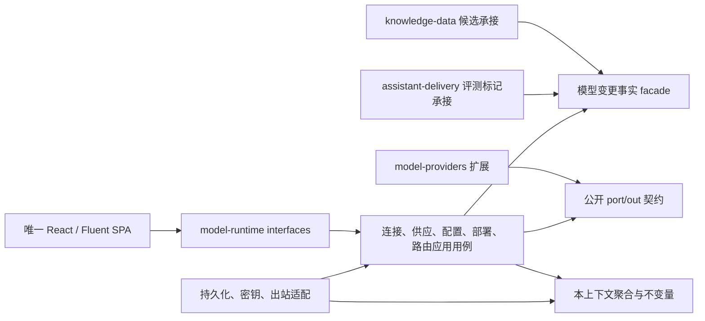

# WP-0019：模型供应与租户使用设计及切片计划

| 字段 | 值 |
| --- | --- |
| 责任任务 | WP-0019 |
| 设计状态 | D1～D5 已人工接受，依据 ADR-0095；不作为已实现事实 |
| 调查基线 | 23b5bae1f847117a2c2a8571f7260bf6b56ac452 |
| 前置产品提交 | 8ade6bbe15a53fdf73a1fea794e642632f59b835 |
| 原型项目 | OpenDesign Cloud 原项目 249f81f2-6f1a-46ff-988c-da3cdedb35e7 |
| 原型已接受基线 | d5deddaa1955814c5f08795b0b1ca58a7e6ac784；2026-10-12 人工接受方舟凭据区修订，先前 35571b0f823390bd6b80f5771e512b11be9403a4 保留为历史基线 |
| 原型入口 | index.html；下表十一项 screen，不新建项目或副本 |
| 原型操作基线 | PAGE-INVENTORY.json、ACTION-LEDGER.json；原人工接受来源见 WP-0016 |
| 日期 | 2026-10-11 |

本文件记录设计、差异分析、切片归属和验收标准，不作为功能完成证据。[生产契约接受记录](contract-proposal.md)及 ADR-0095 已于 2026-10-12 登记；按所属切片实施新增公共契约。当前十一页、二十九操作仍为 `pending-contract`；原型观察不等于生产一致性验收。

## 目标与固定边界

平台管理员建立连接、发现模型、验证并发布可授权部署；租户管理员只在有效授权范围内发现模型、建立配置版本、验证启用、发布部署及路由。连接、配置、部署、路由各自保存，前一步成功不自动完成下一步。

有效输入为工作包所列十项 ADR、ADR-0082、Charter、ROADMAP 和 M6 实现矩阵。ADR-0010 的秘密及出站限制、ADR-0022／0082 的分层与公开门面、ADR-0040 的助手冻结路由、ADR-0066 的平台与租户隔离继续生效；本方案没有接受新安全例外。

范围外为知识接入、索引构建与激活、助手发布和普通问答 UI、多模态能力、生产发布、全厂商重写。配置启用所必需的“重建候选／重新评测标记”只做最小承接，不能借此实现后续包完整生命周期，也不能把未承接事实显示为成功。

假设：部署继续采用现有运行进程；模型业务仍归 `model-runtime`；当前登录与功能上限作为身份输入；真实厂商凭据和有费用调用授权在对应执行切片开始前核实，本轮不读取它们。

## 原型承接与现状差异

OpenDesign Cloud 的原项目注册目录与仓库 `docs/prototypes/wp-0016` 对应；本轮通过项目连接读取完整入口依赖，核对当前树与固定版本无差异。机器清单和模拟状态是设计输入，不能复制为生产存储、身份、厂商健康或计费事实。打开时通过项目连接取得当前预览地址，再选择表内 screen；本地服务端口不作为持久契约。

| 已核实位置 | 调查提交时的事实 | 设计处理与所属切片 |
| --- | --- | --- |
| `PlatformProviderConnectionController` | 已有平台连接创建、列表、probe；没有本控制器的连接发布动作 | S1 补连接详情、独立发布事实及预设联动，不以 VERIFIED 冒充 PUBLISHED |
| `PlatformModelDeploymentController`／`PlatformModelDeploymentService` | 已有创建、probe、publish、disable；源码存在不证明已承接原型授权流程 | S2 明确授权与供应可用性，完成真实接口和页面闭环 |
| `ModelProviderWorkspace` | 旧页面提供租户连接创建和轮换 | S3 改为平台供应的租户发现视图；旧 API 消费者先盘点迁移，不用平台 ID 调用旧租户连接接口 |
| `ModelConfigurationService`／`ModelRuntimeCoreAutoConfiguration` | 三参数构造器允许来源仓储为空，自动配置缺依赖时选择此分支；来源检查遇空返回 | S4 先用缺依赖／旧来源反例复现并移除触及路径的空值绕过，不能推断当前部署已触发漏洞 |
| `ModelType` | 当前部署领域类型为 CHAT、EMBEDDING | S1／S2 补 RERANK 的明确契约与真实探测；不通过名称猜测能力 |
| `DefaultChatRouteExecutor.execute` | 只消费冻结候选，瞬态失败才有限回退 | S6 复用这条执行边界；策略发布不修改既有助手快照 |
| 原型 `simulateRoutingPolicy` | 演示样本数、成本比例和延迟为模拟值 | S6 必须计算真实可追溯模拟结果，不复制 30/30、预算比例或固定 p95 |
| `IndexVersionService.create` | 已有显式创建索引版本用例，冻结可用 Embedding 配置 | S4 另验最小变更候选承接；不能调用构建／发布用例伪装“仅登记候选” |

代码图谱已对 `ModelConfigurationService`、`ChatRouteExecutor`、`ModelProviderWorkspace` 执行影响分析。配置变更涉及生命周期控制器及自动配置；路由涉及助手、查询及其装配测试；供应商页面涉及 `ConsoleApp`。因此按用例纵向切片，不批量重排六个上下文或另造启动模块。图谱不是编译、运行或安全验收证据。

两条已登记分页债务分别随 S3／S4 清理：`ControlledModelCatalogEntryMapper#selectPublishedAvailablePage`、`ModelConfigurationMapper#selectVisiblePage`。先验证来源与授权过滤、固定排序及同范围总数，再在 infrastructure 使用 `Page/IPage` 并递减精确基线；不增加旧目录或手工分页回退。

## 业务所有权与调用边界

图表示包与契约边界，不增加微服务或 Maven 模块。平台与租户是同一上下文内不同所有权，不能把平台供应记录填入租户连接表。跨上下文只用公开 facade；扩展只用公开 port/out 或明确扩展契约，不引用 domain／infrastructure。候选和评测标记分别由知识、助手上下文拥有；模型上下文不反向依赖它们，避免 `knowledge-data → model-runtime → knowledge-data` 编译环。

| 对象 | 所有者与权限 | 写入和读取边界 |
| --- | --- | --- |
| 厂商预设 | 平台控制的版本化非秘密数据 | 保留 CUSTOM、DEEPSEEK、ALIYUN、SILICONFLOW、VOLCENGINE；后端验证选择、区域、能力和地址，前端预填不构成授权 |
| 平台连接及发现 | 平台；现有 `model:platform:write` | 凭据独立加密，运行地址只写；连接发布后仍不自动提供租户模型 |
| 平台部署及租户授权 | 平台 | 冻结连接／发现／能力修订；显式授权到租户；停用或撤权立即阻断新使用 |
| 租户发现 | 当前可信租户；模型管理权限 | 查询平台已发布、健康、验证未过期且已授权的投影；不调用厂商、不接触平台密钥 |
| 租户配置及修订 | 当前租户 | 稳定配置 ID，启用／待验证版本分开；参数和可选租户密钥只影响新修订 |
| 租户部署 | 当前租户 | 冻结已启用配置修订、平台来源、能力与驻留；发布不自动切换助手 |
| 路由策略及模拟 | 当前租户 | 草稿与发布快照分开；修改必须重新模拟；历史助手仍引用原冻结快照 |

平台角色不能以租户身份绕过权限，租户 ID 从可信会话取得，不接受正文或 URL 切换租户。租户停用、管理员资格停用、模型功能关闭、供应撤权都须在命令提交和新调用时重新检查。普通用户个人配置接口不因本轮十一页而开放；已有公开合同的处理须先接受迁移决定。

## 状态、修订与一致性

1. **连接**：草稿保存后单独探测。连接修订绑定预设版本、能力选择、区域、地址、发现配置和凭据版本；探测通过只能证明相应协议结果。发布再检查当前修订与有效探测，生成独立发布事实。任何关键输入变化使旧探测／发现失效；健康与发布时间分开保存。
2. **平台供应**：从当前已发布连接及有来源的候选创建部署草稿。能力验证后才能发布，验证有效期沿用 `PT24H`。发布冻结修订和授权集合；发布对象不原位修改，变更建立新修订。读取目录、租户保存及调用均复核当前来源／授权，不信任旧发现缓存。撤权与停用保留历史记录，不删除租户配置或偷偷切源。
3. **配置**：配置头持有 `activeRevision`、`pendingRevision` 和并发版本；修订持有来源快照、参数、认证模式、私有凭据引用及验证。首次创建为草稿。编辑或轮换创建待验证修订，旧启用修订及其凭据保持不变。验证失败、过期、网络错误、并发冲突均不能切换启用指针；启用时再次复核权限、来源、授权和验证绑定。
4. **部署**：冻结配置 ID 与具体修订，详情展示冻结版本，不能随配置头的新版本漂移。能力、预算、驻留和安全样本通过后才发布；停用前获取真实影响并确认，提交时重新验证影响版本。停用后新调用失败关闭，旧助手不被自动改写。
5. **路由**：新租户可创建草稿。主备不同且属于同租户、同能力、同驻留；修改成员、参数、预算或来源修订使旧模拟失效。发布绑定模拟版本、部署修订和有效性，不靠浏览器按钮状态。运行时仍逐候选检查权限和供应可用性。

数据库提交使用乐观版本和幂等键；成功状态、修订指针、授权／验证记录及必要审计在同一所属事务内提交。秘密不参与幂等摘要。HTTP 调用在事务外：先读取受控快照和短时凭据，调用后再按修订、权限及当前来源进行 CAS 提交；过期响应不得覆盖轮换、停用或新版本。失败保留安全失败码、时间和重试建议，不保存厂商原始正文。

| 能力 | 参数和验证不变量 |
| --- | --- |
| CHAT | 按原型选择 temperature；最大输出为正整数且不超过真实验证上限，输入与输出之和不超过已确认上下文边界 |
| EMBEDDING | 维度为正整数且等于真实响应维度；冻结模型／修订、维度、规范化和距离度量，距离选项承接 COSINE／IP／L2；参数变化不能继续使用旧索引能力快照 |
| RERANK | `1 ≤ evidenceCount ≤ candidateCount ≤ 已验证候选上限`；返回索引在原候选范围内且不重复，得分有限，数量符合 topN；不同厂商响应由各自适配器转换 |

验证记录绑定连接／凭据版本、发现、具体模型及来源部署修订、配置修订、非秘密参数与样本版本。任一绑定变化都不能复用旧记录；凭据版本是私有记录引用或计数，不能用密钥摘要充当绑定。

配置启用事务同时保存不含秘密的变更事实。知识上下文幂等登记受影响知识库的全库重建候选，助手上下文登记需重新评测的影响；以 `(配置 ID, 修订, 目标对象)` 去重，失败重试，禁止自动构建、激活索引或发布助手。异步承接未确认前只能表达影响待处理，不能声称候选已创建；零个受影响对象也须来自真实查询。S4 必须以真实候选／标记持久化和恢复证明承接，只有一条 outbox 或一个 mock 回调不算完成。必要公开变更读取 facade 由模型拥有，消费者沿已有依赖方向读取；未接受该最小契约或消费者未落地时，S4 保持待验证，不能隐藏后置依赖。

路由执行继续保留 ADR-0040 的 Chat 有限回退和 Embedding 不回退。RERANK 采用独立端口，依据 ADR-0095 首版失败关闭、不增加自动回退；不支持的组合安全拒绝，不从演示状态机自行扩大执行权限。策略发布与助手采纳为两件事，WP-0023／WP-0024 继续负责完整助手和问答集成。

## 协议、预设与秘密

以下是 2026-10-11 查阅官方资料后的预设承接范围，表示地址／协议有文档依据，不表示已验证当前账户或具体模型。只实现原型已有选择，官方新增能力不自动扩入本包。

| 预设 | 原型预填与生产核查 | 依据 |
| --- | --- | --- |
| CUSTOM | 公网 HTTPS，自行选择受控能力；真实探测和允许名单通过前不可发布 | ADR-0010、ADR-0070 |
| DEEPSEEK | `https://api.deepseek.com`，当前原型仅 Chat；具体模型 ID 从发现／官方资料确认 | [DeepSeek 首次调用](https://api-docs.deepseek.com/) |
| ALIYUN | 北京 Chat 使用业务空间域名；Embedding 的现有 DashScope 地址仍有官方依据。区域与密钥必须匹配 | [Base URL 总览](https://help.aliyun.com/zh/model-studio/base-url) |
| ALIYUN RERANK | 按已发现且确认的模型选择官方原生重排协议。不同模型可能使用不同路径／请求体，不能将同一地址套用全部 rerank 模型 | [文本排序 API](https://help.aliyun.com/zh/model-studio/text-rerank-api) |
| SILICONFLOW | `https://api.siliconflow.cn/v1`；Chat／Embedding 与独立 `/rerank` 分别验证 | [对话](https://docs.siliconflow.cn/docs/api/chat-completions-post)、[Embedding 官方示例](https://docs.siliconflow.cn/docs/usercases/use-siliconcloud-in-DB-GPT)、[重排](https://docs.siliconflow.cn/docs/api/rerank-post) |
| VOLCENGINE | 北京 `https://ark.cn-beijing.volces.com/api/v3`，当前原型仅 Chat；推理认证与管理面发现认证分别处理 | [Chat API](https://docs.volcengine.com/docs/ark/chat-api?lang=zh&redirect=1)、[管理面鉴权](https://docs.volcengine.com/docs/ark/base-url-and-authentication?lang=zh) |

OpenAI 兼容的 [models 列表](https://developers.openai.com/api/reference/resources/models/methods/list)不能独立证明能力。Ark 发现沿用 ADR-0070 的管理面签名和分页：[ListFoundationModels](https://api.volcengine.com/api-explorer/?action=ListFoundationModels&serviceCode=ark&version=2024-01-01)、[ListEndpoints](https://api.volcengine.com/api-docs/view?action=ListEndpoints&serviceCode=ark&version=2024-01-01)。未知能力保留为待确认候选，不按名称猜测；管理员确认也不能替代真实能力验证。

Chat／Embedding 继续用内部 Port 与 Spring AI；RERANK 用查询、候选、topN 和返回索引／得分的最小端口，明确供应商请求体转换、重复／越界索引、非有限得分和缺失结果的拒绝语义，不伪造 OpenAI 标准接口。

出站逐次验证规范化 HTTPS 主机、DNS 与连接地址；拒绝私网、loopback、元数据、用户信息、任意重定向及主机漂移。业务空间 ID 按 DNS label 校验后构造允许域名，不能把后缀匹配当授权。限制超时、响应体、候选数和分页；不在未知是否已计费时自动重试推理。无原始密钥的客户端缓存不能越过修订与撤权检查。

密钥只出现在专用请求和短时 SecretValue 中；切换厂商／能力、取消、Escape、失败和身份变化清空输入，过期异步结果不得恢复密钥或旧主体数据。平台托管与租户自带认证分别持有引用；租户轮换不能改平台连接或其他租户凭据。API、URL、浏览器持久化、日志、审计、消息、截图及证据均不得包含秘密或密码摘要。

## HTTP 与数据增补提案

以下增补依据已接受 ADR-0095，在所属切片逐项实施；未列为现有的入口不得现在宣称可用。沿用 `WP`／`SLICE` CLI，不新建权限框架。

| 能力 | 现有入口／结构 | 拟增补，所属切片 |
| --- | --- | --- |
| 平台连接 | `/api/v1/platform/model-supply/connections` 的创建、分页、probe | S1：详情、publish、预设读取；保存预设与发布修订，复用已有私有凭据存储 |
| 平台部署 | `/api/v1/platform/model-supply/deployments` 的创建、分页、probe、publish、disable | S2：详情、显式租户授权／撤权与影响查询；授权修订在供应查询与命令内复核 |
| 租户发现 | 旧 `/api/v1/model-providers` 属于租户自有连接，不能混用标识 | S3：独立 `/api/v1/model-supply/connections` 的租户安全投影、详情和 discovery；仅刷新本租户投影 |
| 配置 | `/api/v1/model-configurations` 及 activate／disable | S4：详情、revisions、版本验证和专用轮换；activate 增加目标修订／并发版本绑定；需要旧消费者迁移和契约测试 |
| 租户部署 | 现有部署资源与验证用例 | S5：从已启用配置修订建立部署，冻结来源；补详情、影响确认、发布／停用闭环，不能把旧连接型部署直接视为兼容 |
| 路由 | 现有 ChatRouteExecutor 是执行 facade，不是可编辑策略资源 | S6：拟增 `/api/v1/model-routing-policies` 的草稿、详情、simulation、publish；公开只读冻结快照 facade |

详情 ID、版本号、分页和错误语义须在每片首个红测试前冻结请求／响应样例。客户端按返回的不透明 ID 导航，不自行拼造平台／租户对象映射。查询无业务写副作用；“使用此模型”只导航到预选配置草稿，用户保存前不创建对象。跨租户读取沿现有安全错误约定拒绝，不泄漏对象是否存在。

数据增补仅限平台连接发布修订、平台供应授权、租户发现投影、配置修订和启用指针、部署冻结绑定、路由模拟／发布快照、必要变更事实及消费去重。表名、迁移序号、约束和回滚限制在所属切片按当前 schema 核定，不在设计阶段伪造已存在表。旧数据只迁移可证明的来源绑定；无法证明的记录保留且不可发布，不能重置数据或给任意来源补空值默认。

## 操作归属

下表是切片计划，不是第二份状态源。操作稳定 ID、页面和完成状态仍以 [M6 实现矩阵](../milestones/M6/implementation-map.json)为准；不得删除或合并操作以降低验收。

| 切片 | 原型入口 | 全部责任操作 | 任务结果 |
| --- | --- | --- | --- |
| S1 | platform-model-connections | `platform-model-connections:0`、`platform-model-connections:1`、`platform-model-connections:2` | 新增、查看、厂商／能力／地址联动 |
| S1 | platform-model-connection-detail | `platform-model-connection-detail:0`、`platform-model-connection-detail:1` | 探测后独立发布连接 |
| S2 | platform-model-deployments | `platform-model-deployments:0`、`platform-model-deployments:1` | 可授权部署草稿与目录 |
| S2 | platform-model-deployment-detail | `platform-model-deployment-detail:0`、`platform-model-deployment-detail:1` | 能力验证后发布供应 |
| S3 | model-providers | `model-providers:0`、`model-providers:1` | 当前租户执行发现、查看结果 |
| S3 | model-provider-detail | `model-provider-detail:0`、`model-provider-detail:1` | 重新探测投影、使用模型导航 |
| S4 | model-configurations | `model-configurations:0`、`model-configurations:1` | 受控配置草稿与目录 |
| S4 | model-configuration-detail | `model-configuration-detail:0`、`model-configuration-detail:1`、`model-configuration-detail:2`、`model-configuration-detail:3`、`model-configuration-detail:4` | 修订、轮换、验证、启用、URL 与跨组织隔离 |
| S5 | model-deployments | `model-deployments:0`、`model-deployments:1` | 从启用配置创建部署草稿与目录 |
| S5 | model-deployment-detail | `model-deployment-detail:0`、`model-deployment-detail:1`、`model-deployment-detail:2` | 验证、发布、影响确认后停用 |
| S6 | routing-policies | `routing-policies:0`、`routing-policies:1`、`routing-policies:2`、`routing-policies:3` | 模拟、发布、新租户草稿、编辑后重验 |

## 六个切片的实施和验收

顺序为 S1 → S2 → S3 → S4 → S5 → S6。每片包含后端、数据库、唯一 SPA、真实会话浏览器和原型对照；前片功能与视觉未闭环时不进入后片。新增契约已由 ADR-0095 接受，从 S1 开始实施，不并行扩入后续切片。

### S1：平台连接与厂商预设，5 项操作

- 输入：本设计和专属 ADR 已接受，原型固定版本、现有平台身份与安全出站契约。
- 先红：预设／地址不一致、伪造工作空间、私网及重定向、缺密钥、非平台身份、过期探测发布、重复或迟到探测、取消后秘密残留。
- 结果：平台可保存连接草稿、刷新恢复详情、查看来源清楚的发现摘要并单独发布；失败可重试、不会发布或生成租户模型。
- 证据：真实 API 与事务、受控厂商连接／发现合同、分页、密钥不回显和两页／新增弹窗对照。选择 RERANK 只声明意图，部署能力仍由 S2 证明。
- 正式验收参数：`SLICE=platform-connection`，执行模式见下文；入口已实现不表示生产验收通过。

### S2：平台部署、能力验证与租户授权，4 项操作

- 输入：S1 发布连接；真实模型候选和独立受控调用授权。补最小 RERANK Port 与厂商适配，不建立通用插件框架。
- 先红：未经确认候选、只探测连接即发布、维度与响应不符、RERANK 越界／重复结果、过期验证、连接轮换竞态、未授权租户可见、撤权后继续调用。
- 结果：草稿冻结连接与模型，验证能力／预算／驻留／安全样本后发布，显式授予选中租户；API 撤权／停用与影响事实有效，不伪造原型没有的按钮。
- 证据：Chat、Embedding、所声明 rerank 的真实合同分别登记；确定性桩仅证明协议反例。授权、发布、审计失败回滚及并发提交真实数据库验证；两页和授权弹窗对照。
- 拟验收参数：`SLICE=platform-supply`。

### S3：租户发现与配置导航，4 项操作

- 输入：S2 有效供应和当前租户授权；不需要租户取得平台凭据。
- 先红：其他租户、停用／过期／撤权供应混入结果，陈旧缓存继续授权；空目录崩溃；同名模型误选；“使用此模型”暗中写库；伪造对象 URL。
- 结果：发现／重新探测只更新当前租户的安全目录投影；查看和预选配置导航保持精确对象上下文，刷新与返回恢复页码和筛选。
- 证据：发现请求没有厂商外呼或秘密读取；无权对象不可枚举，21／101 条规模下筛选分页／总数正确；两页对照。触及目录分页债务在本片清理。
- 拟验收参数：`SLICE=tenant-discovery`。

### S4：配置修订、轮换、验证与启用，7 项操作

- 输入：S3 安全供应；来源校验必需依赖；配置变更事实及知识候选／助手标记的最小承接契约已接受。
- 先红：缺来源依赖仍启用、越租户详情、轮换覆盖旧凭据、验证失败改变启用版本、旧验证覆盖新修订、并发双启用、撤权后启用、候选重复／消费失败丢失。
- 结果：参数编辑和密钥轮换都创建待验证版本；真实验证后显式启用，旧版本在此之前继续服务。Embedding 语义变化生成真实重建候选；Chat／Rerank 变化登记重新评测影响，不自动切助手或激活索引。
- 证据：旧版本调用正例，新版本失败／取消不影响旧版本，启用 CAS／审计回滚，变更事实重复／恢复后候选和标记恰好一次；两页、参数与密钥弹窗、URL 恢复和跨组织拒绝对照。两条来源／空值与配置分页问题均在触及路径先红后绿。
- 拟验收参数：`SLICE=configuration`。消费者未落地时不得把启用完整语义判为通过。

### S5：租户部署生命周期，5 项操作

- 输入：S4 真实启用修订和当前平台授权。
- 先红：草稿／待验证配置可选、错误能力或驻留、配置更新使冻结部署漂移、旧验证发布、影响未确认即停用、影响查询后新增绑定竞态、停用后继续新调用。
- 结果：从启用配置建立冻结部署，验证后发布；详情展示真实影响，确认后停用；没有可用冻结路由时失败关闭。
- 证据：发布不改助手／索引、停用不删除历史，冻结修订及并发影响确认的真实接口和数据库事实；两页／停用弹窗对照。
- 拟验收参数：`SLICE=tenant-deployment`。

### S6：路由模拟、发布与整包复验，4 项操作

- 输入：S5 同租户同能力同驻留的可用部署；专属 ADR 明确支持能力与失败语义；可追溯模拟样本、单价和负载依据。
- 先红：重复主备、跨租户／能力／驻留、不可用来源、伪造预算、缺计价／负载事实、修改后沿用旧模拟、发布后改变旧助手快照、权限错误自动回退。
- 结果：新租户创建草稿、保存参数后真实模拟并发布不可变修订。首版使用固定版本的 30 项合成路由反例集逐项执行，实际通过数／总数从结果计算；其版本与非秘密输入绑定模拟。成本用有币种、计费单位和版本的单价乘已声明月负载及每样本用量计算；p95 来自本次受控样本耗时，不冒称生产 SLA。缺少这些依据则返回未验证、禁止发布，不用预算乘比例代替。
- 证据：每样本结果可复核，边界拒绝算对应反例通过；修改和撤权使旧模拟失效；Chat 瞬态失败有限回退与已输出／授权错误不回退分别证明；路由页、空组织表单和编辑失效状态对照。真实助手采纳仍属 WP-0023，不冒称完整问答已交付。
- 拟验收参数：`SLICE=routing`；完成六片后另执行无 SLICE 的整包集成复验，不以六份孤立结果代替。

## 通用验收门禁与交付记录

功能验收与视觉一致性分别结论；页面与操作状态只有在对应完整证据绑定真实提交后才更新。每片必须覆盖真实身份、权限交集、成功／失败／取消／重复／并发／过期、刷新恢复、分页规模、审计和事务事实。领域／HTTP／适配器测试通过不能替代真实 Compose 浏览器与数据库事实。

视觉以原项目当前固定版本为准：七态 `loading / empty / error / denied / partial / disabled / success`，尺寸 `390×844 / 1024×900 / 1440×1000`；全包至少 231 个页面状态与尺寸组合，另外覆盖所有操作表单／弹窗、200% 文字、键盘焦点和 reduced-motion。核对暖色画布、16px 正文、Georgia／中文宋体标题、15rem 侧栏、36／32／44px 控件和短按钮内容宽度；具体选择器与尺寸从原型获取，不新设放宽容差。不得出现裁切、遮挡、横向溢出或无法操作的焦点；不能自行增加模型页面视觉例外。

本包正式入口当前仅实现 `make acceptance-work-package WP=WP-0019 SLICE=platform-connection`。S2～S6 及不带 SLICE 的整包入口未实现，未知 SLICE、缺证据和不安全凭据文件失败关闭。现有 `make acceptance-model-provider`／`make acceptance-model-deployment` 只作为旧合同回归，不自动覆盖本包。完整验收区分受控写入、只读复验、真实厂商调用和视觉对照，不能在只读模式隐式建对象。

S1 共同输入为 `FOUNDATION_ACCEPTANCE_CREDENTIALS_FILE`（当前用户拥有的普通 0600 文件，含平台及租户验收身份），以及分别固定的 `FOUNDATION_ACCEPTANCE_FRONTEND_REVISION`、`FOUNDATION_ACCEPTANCE_BACKEND_REVISION`（完整 SHA）。执行前只读检查已提交且干净的源码及本项目七个 Compose 服务，四应用 OCI revision 必须分别匹配；不能把 HEAD 当作运行版本。Playwright 固定为 1.62.1，仍由既有 NODE_PATH 提供。入口不读取容器环境、导出数据库秘密或重设密码。

| `FOUNDATION_ACCEPTANCE_MODE` | 额外输入与边界 |
| --- | --- |
| `read-only`（默认） | 精确 `FOUNDATION_ACCEPTANCE_CONNECTION_ID`、`FOUNDATION_ACCEPTANCE_CONNECTION_VERSION`。真实会话、平台／租户／匿名隔离、分页、详情刷新、五厂商联动、取消及三尺寸／200% 文字；拦截全部模型业务写入，前后连接事实相同，不读取创建材料。 |
| `create-draft` | 普通 0600 的 `FOUNDATION_ACCEPTANCE_CONNECTION_FILE` 及新的输出文件，不能同时指定既有 ID／版本。材料含 providerPresetId、capability、只写 apiKey，按选择补充 workspaceId、自定义 endpoint 或方舟独立 AK/SK；拒绝未知字段和固定地址覆盖。正式表单仅保存一个合成名称草稿，不探测、不发布，不删除对象。 |
| `vendor-discovery` | 精确既有 ID／版本及新的输出文件。协议与用途凭据匹配时只执行一次正式最小发现；不能用确定性结果、空候选或 HTTP 200 的失败结果冒充真实合同，不推理、不发布，不自动重试。 |
| `publish-current` | 精确既有 ID／版本及新的输出文件。当前修订验证未过期且未发布时，仅通过真实详情发布本修订，不自动探测，不建立部署或租户授权。 |

除默认只读外，执行模式须与用户授权的动作和对象匹配；发现授权不包含发布。`FOUNDATION_ACCEPTANCE_OUTPUT_FILE` 必须为 `/private/tmp` 下当前用户独占 0700 目录中的新文件，以 0600 建立；只读不指定时不生成报告。输出只保存模式、检查结果、运行事实及精确对象，不保存输入材料、认证信息、浏览器 trace 或截图。每个模式通过只证明该模式范围，输出始终保留 `sliceComplete=false`、`prototypeParity=NOT_RUN`；数据库事实与固定版本原型视觉单独登记。

本地及 CI 执行 `make work-package-acceptance-test`，只验证分派、模式、版本、用途、分页和安全输出合同，不启动生产浏览器或访问厂商。创建、发现与发布仍需各自真实执行证据，入口测试不替代这些门禁。

每片收口记录：责任操作、完整源码 SHA、前端运行 revision／镜像、后端运行 revision／镜像、原型项目／版本、验证时间、命令与范围、厂商真实调用的授权及脱敏结论、精确对象的只读数据库计数／状态、视觉结论及临时截图位置。控制面提交与运行源码分开，历史证据不改日期。凭据由安全文件提供，只记录安全性检查结果，不记录内容；截图、详细日志和一次性报告仅放仓库外。

实施时验证：所属领域／事务／接口／自动配置测试，`./mvnw -q -pl backend/contexts/model-runtime -am test` 及实际受影响扩展／消费者模块，`make frontend-test`、`make architecture-guard`、相应业务验收、`make project-verify`、`make resume-context`。整包收口另完成完整后端 Maven 验证、六片集成、当前 Compose 浏览器及原型一致性；技术通过不代替 M6 人工接受。

每片精确路径中文提交、检查秘密和用户差异后正常推送 Git；推送后核对远端精确 SHA 和适用 CI。未经接受的契约、未验证的功能不因已推送而成为完成事实。

## 当前进度与下一动作

- 已交付到本轮设计：十一入口／二十九操作归属、六片顺序、现有差异与触及债务、生产契约提案、逐片及整包验收标准。执行核对证据见本任务 evidence。
- 已人工接受：D1～D5 于 2026-10-12 登记 ADR-0095；设计接受不替代逐片实施与验收。
- 源码进展：S1 连接独立发布后端与隔离事务已验证，见[源码证据](evidence/WP-0019-S1-connection-publication-source-20261012.md)；不表示 S1 五项操作或生产验收完成。
- 原型修订已接受：用户明确接受 `d5deddaa1955814c5f08795b0b1ca58a7e6ac784` 并要求按该版本继续 S1，见[人工接受记录](evidence/WP-0019-S1-prototype-acceptance-20261012.md)。只读连接详情源码及原型状态／浏览器回归已验证，见[候选执行证据](evidence/WP-0019-S1-discovery-credentials-and-detail-source-20261012.md)，没有部署或真实厂商调用。
- 预设来源子任务：`c52669a9bdba52b25aba2efdbd7694c617df6aa1` 已通过来源绑定、草稿安全及分页源码回归，见[执行证据](evidence/WP-0019-S1-preset-source-and-existing-connection-check-20261012.md)。现有登录已复用；旧连接的发现被 DNS 出站策略拒绝且缺少方舟独立 AK/SK，未到达厂商，不构成真实厂商通过。
- 源码进展：`fc970f9ec5a07da1eb41cc80ec84f31d93469f48` 已完成重发现时效／原子 CAS、非秘密配置事实、五厂商表单及详情交互验证，见[源码执行证据](evidence/WP-0019-S1-connection-consistency-source-20261012.md)；完整后端 1124 项、前端 267 项、隔离浏览器 29 项通过，不代替生产验收。
- 验收工具：正式 S1 入口已落地，默认只读，草稿、真实发现与发布分别显式选择；本地／CI 合同测试不代替实际执行证据。
- 前轮部署复验：`3efce6946c7af8f934a7bfaa9928c8b77df046a4` 的正式只读 10 项与精确数据库事实通过，业务写入 0；当轮后端运行 `dbe0d5d0f780bd867c8f2b1a2afdcd48c1d51195`。过期发布提示、标题排版、前端 274 项及隔离浏览器 32 项已验证，见[执行证据与差异清单](evidence/WP-0019-S1-deployed-read-only-and-parity-audit-20261012.md)。标题局部 36 项匹配不代表完整一致性；当轮查询及其他差异由后续证据承接，真实厂商和写模式生产闭环仍未通过。
- 目录查询：用户于 2026-10-13 接受提案并登记 ADR-0096。服务端有界搜索、全目录发布摘要、两页完整分页与恢复已实现，见[源码与部署记录](evidence/WP-0019-S1-directory-query-source-and-deploy-20261013.md)。后端 1132 项、前端 277 项、隔离浏览器 29＋32 项通过；当轮前端运行 `753aec9250821541fd87b3c9c89e689d773b8e2a`，后端三应用运行 `7906451e3f2e04a03e098e601b37425e29857cb5`，四入口健康及精确事实通过，不替代生产浏览器。
- 前轮验收：10 月 14 日两个现存环境登录来源各执行一次均 401，精确平台主体／资格仍活动，S1 页面断言未运行；七服务健康及四入口通过，见[执行时点证据](evidence/WP-0019-S1-acceptance-blockers-and-prototype-empty-20261014.md)。用户随后接受空态文案及既有操作修正，当前原型版本与人工决定见[接受记录](evidence/WP-0019-S1-prototype-acceptance-20261012.md)和本包 README；不在此维护第二个现行版本指针。
- 待完成：两页／弹窗完整七态及匹配新预设的真实厂商合同。完整地址已于 2026-10-15 [人工接受](evidence/WP-0019-S1-prototype-acceptance-20261012.md)并完成[生产承接子任务](evidence/WP-0019-S1-address-production-delivery-20261015.md)；随后[拒绝态恢复生产承接](evidence/WP-0019-S1-denied-production-delivery-20261015.md)闭环，原排查记录保留历史时点。真实草稿保存由下述证据承接；S2～S6 和二十九项生产完成状态不提升。
- 后续复验：登录及 DNS 阻断解除，既有连接真实发现和单独授权的精确发布通过，最终生产只读十项通过，见[执行证据](evidence/WP-0019-S1-auth-vendor-publish-and-parity-20261014.md)。属性量测匹配不代替人工视觉；原型与生产的文字放大重叠、共享色彩、七态对照及尚缺的真实写入 / 新协议合同继续阻断 S1 完成。具体运行版本、下一动作和有效输入只由本包 README 恢复，不进入 S2。
- 原型承接修复：已接受手机版本的内容高度、范围色彩、滚动避让、身份焦点和加载／错误页已局部闭环，真实保存一个未探测／发布的合成 DRAFT，见[最新执行证据](evidence/WP-0019-S1-mobile-parity-and-draft-20261014.md)。常用视图及独立负态量测通过；原生地址专项、完整七态和新方舟认证仍待验证。前节保留原执行时点，实时版本与下一动作继续只从 README 恢复；WP-0019、M6 未完成。
- WP-0019 整包与 M6 未完成；WP-0020～后续知识、索引、助手、普通问答和治理概览仍按原责任包推进。
